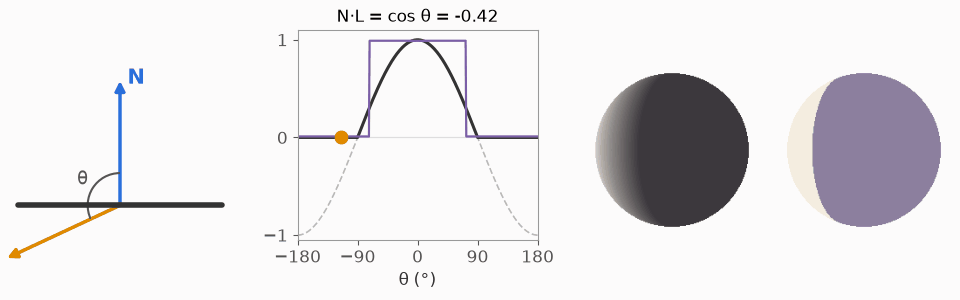

[日本語](README.ja.md) | [English](README.md) | [한국어](README.ko.md)

# Normals Tips (illustrated)

An illustrated guide to **normals** in 3D graphics, with animations and interactive figures.

**▶ Interactive figures (GitHub Pages): https://gyogy6.github.io/Sayu_NormalsTips_WebPages/en/**

## Contents

1. [What is a normal?](en/01_what-is-a-normal.md) — how the facing of a surface and the light angle decide brightness
2. [Face normals and vertex normals](en/02_face-and-vertex-normals.md) — flat vs. smooth, and splitting by angle
3. [How to average vertex normals](en/03_averaging-vertex-normals.md) — uniform, area-weighted and angle-weighted
4. [Hard edges and UV seams](en/04_hard-edges-and-uv-seams.md) — split vertices do not break the shading; split normals do
5. [Custom normals](en/05_custom-normals.md) — change only the shading, keep the shape
6. [Seams between separate meshes](en/06_seams-between-meshes.md) — why the shading breaks, and common ways to match normals
7. [Why toon shading shows normal errors](en/07_why-toon-shows-normal-errors.md) — the threshold, and how much the surface curves
8. [Normal maps](en/08_normal-maps.md) — a normal map is built on top of the vertex normals
9. [Things to watch on export and import](en/09_export-and-import.md) — normals can be rebuilt along the way

## License

- Text and figures: [CC BY 4.0](LICENSE-docs.md)
- Code: [MIT](LICENSE)
