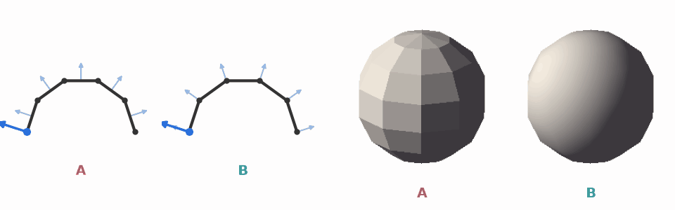
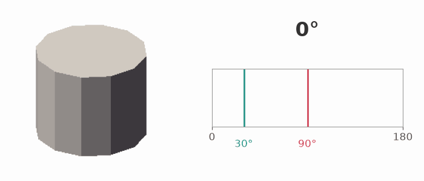

[日本語](../ja/02_face-and-vertex-normals.md) | [English](../en/02_face-and-vertex-normals.md) | [한국어](../ko/02_face-and-vertex-normals.md)

[Contents](../README.md) · [← 1. What is a normal?](01_what-is-a-normal.md) · Next: [3. How to average vertex normals →](03_averaging-vertex-normals.md)

# 2. Face normals and vertex normals



*A: flat, B: smooth. The two on the left are cross sections; the blue point moves along the surface and shows its normal. In A the direction jumps at each face border; in B it turns smoothly. The two on the right are the same low-poly sphere lit with each kind of normal.*

**▶ Try it: [interactive figure (GitHub Pages)](https://gyogy6.github.io/Sayu_NormalsTips_WebPages/en/ch02.html)**

## Face normals

For a triangle with vertices `a, b, c`, the face normal is the **cross product** of two edges:

```
n = normalize( (b - a) × (c - a) )
```

The direction of the cross product depends on the vertex order, so a reversed order gives a reversed normal (the "front and back" from chapter 1).
Also, the **length** of the cross product is twice the triangle's area. Chapter 3 uses this.

## Vertex normals

For drawing, normals are stored **per vertex**. For each pixel inside a triangle, the three vertex normals are blended by position (interpolated), brought back to length 1, and then used for lighting.

So the normals you put on the vertices decide how the inside of each face looks.

### Flat (use the face normal as is)

All three corners of a triangle get that face's normal. The direction is the same everywhere in the face, so is the brightness. Each face is visible and the surface looks faceted.

### Smooth (use the average of the surrounding faces)

Each vertex gets **the average of the normals of the faces that share it**. Neighboring triangles share the same direction there, so it does not jump at face borders and the brightness flows smoothly.

But only **the shading** changes. The shape (vertex positions) stays the same, so **the outline (silhouette) stays angular**. Look at the rim of sphere B in the GIF: it is still a polygon.

## Splitting by angle

Making everything smooth causes a problem: **real corners**, such as where the top of a cylinder meets the side, get rounded too, and the shading bleeds across them.

A common fix: **split the normals only where neighboring faces meet at more than a threshold angle**, so those places stay sharp.



*A 12-sided cylinder. Side faces meet at 30°, the top meets the sides at 90°. The threshold goes from 0° to 180°.*

- Threshold **below 30°**: everything is split, so everything is flat.
- **30° up to (but not including) 90°**: the sides join smoothly and only the top rim stays sharp. This is usually the look you want.
- **90° or more**: the top and the sides blend, and shading bleeds onto the top.

(In this figure, the decision compares the angle between face normals.)

## Several normals at one position

Where normals are split, **one position has a different normal for each face**. In drawing data a vertex can carry only one normal, so the vertex is **split into separate vertices at the same position**. Turn on "Show vertex normals" in the interactive figure to see two normals at each point on the cylinder rim.

Normals do not connect across a split. Chapter 4 (hard edges and UV seams) looks at this more closely.

## Summary

- A face normal comes from the cross product of its edges.
- Normals are stored per vertex and interpolated inside each triangle.
- Flat uses the face normal; smooth uses the average of the surrounding faces. Smooth does not change the outline.
- A threshold angle decides which places are smooth and which are sharp. Vertices are split at the sharp places.

---

[Contents](../README.md) · [← 1. What is a normal?](01_what-is-a-normal.md) · Next: [3. How to average vertex normals →](03_averaging-vertex-normals.md)
