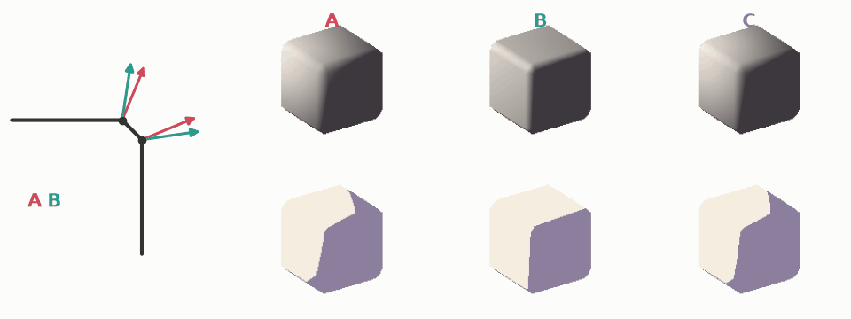
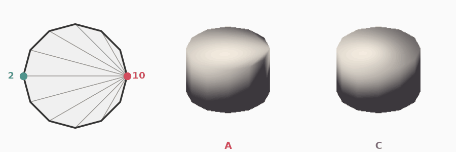

[日本語](../ja/03_averaging-vertex-normals.md) | [English](../en/03_averaging-vertex-normals.md) | [한국어](../ko/03_averaging-vertex-normals.md)

[Contents](../README.md) · [← 2. Face normals and vertex normals](02_face-and-vertex-normals.md) · Next: [4. Hard edges and UV seams →](04_hard-edges-and-uv-seams.md)

# 3. How to average vertex normals

**▶ Try it: [interactive figure (GitHub Pages)](https://gyogy6.github.io/Sayu_NormalsTips_WebPages/en/ch03.html)**

Chapter 2 said "smooth = the average of the surrounding face normals". But **there is more than one way to average**, and the choice changes the shading of the same mesh.

## The formula

With surrounding face normals `n₁, n₂, …` and weights `w₁, w₂, …`:

```
vertex normal = normalize( w₁·n₁ + w₂·n₂ + … )
```

The only difference is **how the weight `w` is chosen**. Three common choices:

| | Weight | Good at | Watch out for |
|---|---|---|---|
| **A Uniform** | 1 for every face | Simplest | Result depends on how faces are split into triangles |
| **B Area-weighted** | Face area | Keeps the direction of large faces | Small faces barely count |
| **C Angle-weighted** | The face's corner angle at the vertex | Not affected by triangulation | Ignores large vs. small faces |

B is just the sum of the cross products **without normalizing them** (their length is twice the area). It is the cheapest to compute, so it is used a lot.

## Example 1: a beveled box



*Left: cross section of a beveled corner. At a vertex between a wide face and a narrow bevel, A (uniform) points exactly between the two faces, while B (area-weighted) stays close to the wide face. Right: the same box with A, B and C (top: smooth, bottom: toon).*

- With **B**, the wide faces keep an almost flat brightness and the bending gathers on the narrow bevels. This is the look of a hard, machined object.
- With **A** and **C**, shading flows onto the edges of the wide faces, and in toon shading a shadow line cuts into the wide face.

## Example 2: how the triangles are split



*Left: the cylinder cap seen from above, split as a fan from one vertex. 10 triangles meet at the red vertex, 2 at the green one. Right: A (uniform) and C (angle-weighted), with the cylinder turning.*

The cap is one flat surface, but after triangulation each vertex touches a different number of triangles.

- **A (uniform)** weights by the number of triangles, so the red vertex with 10 triangles is pulled strongly toward the cap direction. As the cylinder turns, the shading bends only there.
- With **C (angle-weighted)**, however a flat area is split, **the angles around the vertex add up to the same total** (150° here). The normal is the same whatever the triangulation.

Triangulation can change automatically, for example on export. A method whose shading depends on it, like A, is at a disadvantage there.

## Which one is right?

**None of them is the single right answer.**

- Round things (spheres, faces) often look natural with C (angle-weighted).
- Hard objects with bevels suit B (area-weighted).
- A is simple but depends on the triangulation.

The key point: **the same mesh shades differently when normals are computed differently.** Each application or setting may use a different method, so recomputing normals somewhere else can change the shading. Later chapters cover storing your own normals (custom normals) and what to watch for on export and import.

## Summary

- A vertex normal is a **weighted average** of the surrounding face normals.
- Common weights: uniform, area and angle.
- Area weighting protects large faces; angle weighting does not depend on triangulation.
- A different method gives different shading. There is no single right answer.

---

[Contents](../README.md) · [← 2. Face normals and vertex normals](02_face-and-vertex-normals.md) · Next: [4. Hard edges and UV seams →](04_hard-edges-and-uv-seams.md)
