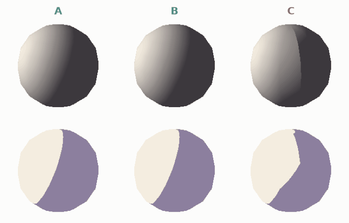

[日本語](../ja/04_hard-edges-and-uv-seams.md) | [English](../en/04_hard-edges-and-uv-seams.md) | [한국어](../ko/04_hard-edges-and-uv-seams.md)

[Contents](../README.md) · [← 3. How to average vertex normals](03_averaging-vertex-normals.md) · Next: [5. Custom normals →](05_custom-normals.md)

# 4. Hard edges and UV seams

*A sphere whose vertices are split along the vertical line in front. A: not split. B: split, but the normals match. C: split, and the normals were computed separately on each side. Top: smooth, bottom: toon.*

**▶ Try it: [interactive figure (GitHub Pages)](https://gyogy6.github.io/Sayu_NormalsTips_WebPages/en/ch04.html)**

## A vertex for drawing is a bundle of data

The vertex you see while modeling is a position. The vertex used for drawing is **the whole bundle: position, normal, UV, color and so on**. If **any one of them differs, it is a different vertex**.

So in places like these, two or more vertices sit at the same position:

| Place | What differs | Vertices |
|---|---|---|
| Hard edge (where chapter 2 "splits by angle") | Normal | Split |
| UV seam | UV | Split |
| Vertex color border, etc. | Color, etc. | Split |

This is why the vertex count for drawing is larger than the one you see while modeling.

## Split vertices do not break the shading

The key point: **being split does not affect the shading by itself.**

- **A and B look the same.** B is like a UV seam: the vertices are split, but both sides carry **the same normal**, so the shading stays connected.
- **Only C breaks.** Each split vertex carries a normal averaged from **only the faces on its own side**. The two sides point differently, so the brightness disagrees along the seam.

What breaks the shading is not "split vertices" but **"split vertices with different normals"**.

## When C tends to happen

Hard edges split normals on purpose, so they are fine. The trouble is when you get **C without meaning to**:

- The mesh was cut apart at the seam before the normals were computed.
- The positions overlap, but the vertices are not merged (not connected).
- On export or import, normals were recomputed without looking at connectivity.
- The seam alone got its normals from a different method.

In every case, the cause is that the faces on both sides were not averaged together.

## How to check

- **Show the vertex normals**: one normal on each seam point means B; two different normals mean C.
- **Turn the light with toon shading**: as in chapter 1, toon shading turns tiny normal differences into lines. A shading line along the seam means the normals disagree.

## Summary

- A vertex for drawing is a bundle (position, normal, UV, …). If one part differs, the vertex splits.
- Split vertices with matching normals do not break the shading (a normal UV seam is like this).
- The shading breaks when split vertices have different normals. Averaging the faces on both sides together fixes it.

---

[Contents](../README.md) · [← 3. How to average vertex normals](03_averaging-vertex-normals.md) · Next: [5. Custom normals →](05_custom-normals.md)
