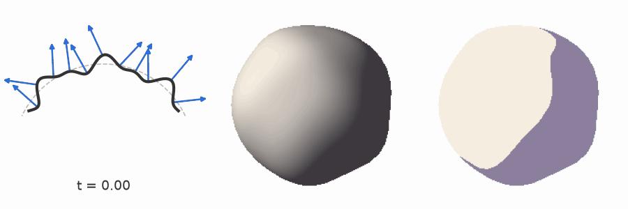

[日本語](../ja/05_custom-normals.md) | [English](../en/05_custom-normals.md) | [한국어](../ko/05_custom-normals.md)

[Contents](../README.md) · [← 4. Hard edges and UV seams](04_hard-edges-and-uv-seams.md) · Next: [6. Seams between separate meshes →](06_seams-between-meshes.md)

# 5. Custom normals

*Left: a cross section of a bumpy surface and its normals. At t = 0 they follow the surface; at t = 1 they are the normals of the dotted circle (pointing out from the center). Middle and right: the same on a bumpy sphere (smooth / toon). The outline stays bumpy.*

**▶ Try it: [interactive figure (GitHub Pages)](https://gyogy6.github.io/Sayu_NormalsTips/en/ch05.html)**

## Normals do not have to come from the shape

So far, normals were computed from the shape (the vertex positions). But as chapter 1 showed, **only the normals decide the shading.**

So instead of the computed normals, you can **store normals of your own choosing on the vertices**. These are **custom normals**.

- The shape (vertex positions) does not change, so **the outline does not change**.
- Only **the shading** changes.

## Common ways to set them

1. **Set the direction directly**: select vertices and specify the normal direction.
2. **Copy from another shape (transfer)**: prepare a simple shape nearby (sphere, ellipsoid, cylinder, …) and copy the normal of the nearest point.
3. **Smooth them**: average with the normals of neighboring vertices to reduce noise.

Method 2 fixes many vertices at once, so it is used a lot. The GIF uses it too: the normals of a smooth sphere are copied onto a bumpy sphere.

## Example: toon shading on a face

A toon face has small bumps (nose, mouth, cheeks), so with computed normals the shadows easily become blotchy. As chapter 1 showed, toon shading turns small differences near the threshold into lines.

If you copy normals from a simple shape that wraps the whole face (a sphere, an ellipsoid, …), the shadow becomes a clean shape, **like the shadow of that simple shape**. The geometry is unchanged, so the side outline and the height of the nose stay the same.

How much to copy (t in the GIF) is **decided by eye**:

- Small t: shadows that follow the shape, but blotchy.
- Large t: clean shadows, but the bumps no longer show in the shading, and it can look flat.

Changing t by area (for example, strong around the eyes and weak toward the edges) is also common.

## Watch out for

- **Shape and shading stop matching**: a dent that is lit, for example. Too much looks unnatural.
- **The outline does not change**: normals cannot remove bumps in the silhouette.
- **Recomputing removes them**: operations that recompute normals (changing the angle-split setting, editing the shape, recomputing on export or import, …) can wipe custom normals. Check that they survive your workflow.
- **They affect normal maps**: normal maps are based on the vertex normals, so changing vertex normals also changes how a normal map looks (chapter 8).

## Summary

- Custom normals are normals you choose instead of computing. They change the shading, not the shape.
- Copying from a simple shape (transfer) fixes many vertices at once.
- They are often used to clean up toon shading on faces. How much to copy is decided by eye.
- Recomputing can remove them, so check that they are kept.

---

[Contents](../README.md) · [← 4. Hard edges and UV seams](04_hard-edges-and-uv-seams.md) · Next: [6. Seams between separate meshes →](06_seams-between-meshes.md)
