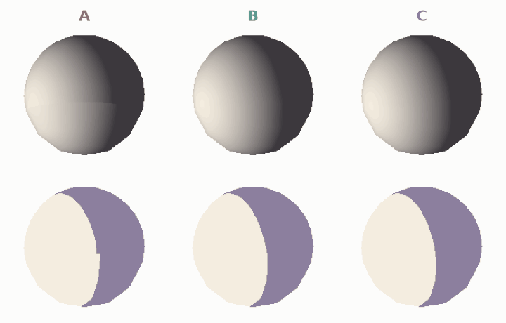
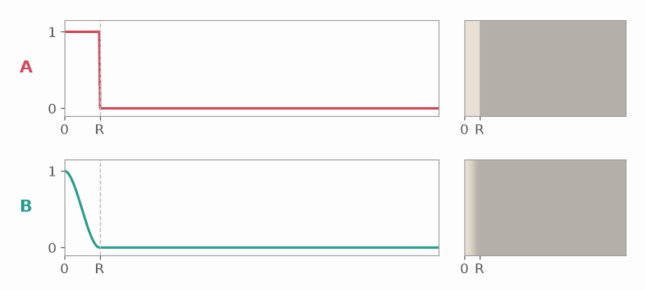

[日本語](../ja/06_seams-between-meshes.md) | [English](../en/06_seams-between-meshes.md) | [한국어](../ko/06_seams-between-meshes.md)

[Contents](../README.md) · [← 5. Custom normals](05_custom-normals.md) · Next: [7. Why toon shading shows normal errors →](07_why-toon-shows-normal-errors.md)

# 6. Seams between separate meshes



*A sphere whose upper and lower parts are separate meshes (with different density). A: as is. B: only the seam vertices get matching normals. C: near the seam, normals are copied from a smooth shape, weaker with distance. Top: smooth, bottom: toon.*

**▶ Try it: [interactive figure (GitHub Pages)](https://gyogy6.github.io/Sayu_NormalsTips/en/ch06.html)**

## Why the shading breaks

Where **separate meshes meet**, such as face and neck, hand and sleeve, or body and clothing, the shading can break even when the positions match exactly.

The reason is the same as C in chapter 4. Each mesh averages its vertex normals from **only its own faces**. A seam vertex is averaged from only the upper faces in one mesh and only the lower faces in the other, so **the two sides point differently**. That is the step at the seam in the bottom row (toon) of A.

If the two meshes also have different density, the normals near the seam behave differently as well.

## Method 1: match the seam normals

The simplest fix is to **give the vertices on both sides of the seam the same normal**:

- Average the faces on both sides together (compute as if joined).
- Or make one side follow the other side's normals.

This is B in the GIF; the step disappears. The normals are stored as custom normals (chapter 5).

## Method 2: copy normals (transfer)

To clean up **the surroundings too**, not just the seam vertices, use "copy from another shape" from chapter 5. The source can be, for example:

- the other mesh,
- the two meshes joined,
- a smooth stand-in shape that wraps across the seam.

C in the GIF copies normals from a smooth sphere within range R of the seam.

## Method 3: weaken with distance (falloff)

If you switch suddenly from "copied normal" to "original normal" at the edge of the range, **a new step appears there**.



*Horizontal: distance from the seam. Vertical: copy strength w (1 = fully copied, 0 = original). The strip on the right is the resulting brightness. A: a sudden switch at range R. B: a smooth falloff with distance. R changes over time.*

So the copy strength `w` is **weakened gradually with the distance from the seam**, and the normals are blended:

```
normal = normalize( original × (1 - w) + copied × w )
```

As in B, copy fully at the seam and fade to 0 at the edge of the range, and the brightness connects smoothly. A smooth curve whose slope is 0 at the ends hides the border better than a straight line.

## Watch out for

- **Seam vertices that do not line up in position or count**: when there is no vertex at the same position, copy from the nearest point.
- **After deformation**: bending with bones or changing expressions also changes normal directions. Check that the seam still matches after deformation.
- **Recomputing removes them**: as in chapter 5, check that the matched normals are not recomputed on export or import.

## Summary

- Separate meshes average normals from their own faces only, so normals disagree at the seam even when positions match.
- Matching the seam normals removes the step.
- To clean up the surroundings, copy normals from a source shape.
- Weaken the copy with the distance from the seam, so the edge of the range does not create a new step.

---

[Contents](../README.md) · [← 5. Custom normals](05_custom-normals.md) · Next: [7. Why toon shading shows normal errors →](07_why-toon-shows-normal-errors.md)
