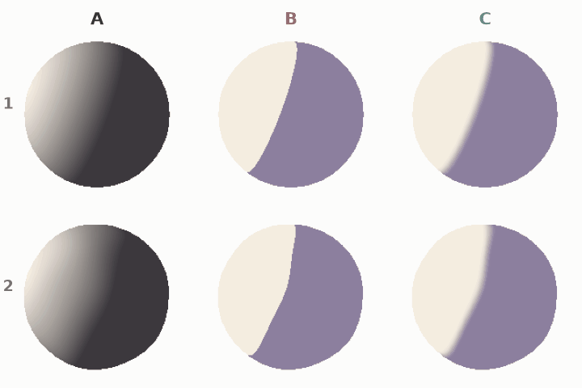
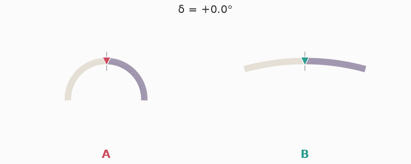

[日本語](../ja/07_why-toon-shows-normal-errors.md) | [English](../en/07_why-toon-shows-normal-errors.md) | [한국어](../ko/07_why-toon-shows-normal-errors.md)

[Contents](../README.md) · [← 6. Seams between separate meshes](06_seams-between-meshes.md) · Next: [8. Normal maps →](08_normal-maps.md)

# 7. Why toon shading shows normal errors



*1: a smooth sphere. 2: a sphere with bumps so small you can hardly see them. A: smooth brightness. B: toon. C: toon with a slightly softened shadow edge.*

**▶ Try it: [interactive figure (GitHub Pages)](https://gyogy6.github.io/Sayu_NormalsTips/en/ch07.html)**

Earlier chapters kept saying "normal differences stand out in toon shading". This chapter looks at the two reasons.

## Reason 1: the threshold flips the brightness all at once

With smooth brightness `max(0, N·L)`, tilting the normal a little (δ) changes the brightness only a little, roughly

```
change in brightness ≈ sin θ × δ
```

(θ is the angle to the light, δ in radians). For δ = 2°, the change is at most about 0.035, which the eye barely notices. That is why row 2 of A looks almost the same as row 1.

With toon shading, when `N·L` crosses the threshold, **the lit color and the shadow color swap completely**. However small δ is, the change is "one full step". So small normal noise near the threshold shows up directly as **the shape of the shadow edge** (the wobbly edge in row 2 of B).

## Reason 2: on gentle surfaces, the shadow edge moves further

The other reason is how much the surface **curves**.



*A: a tightly curved surface (small radius). B: a gently curved surface (large radius). Both have their normals tilted by the same angle δ. ▼ marks the shadow edge.*

The shadow edge is where `N·L` equals the threshold. Tilt the normals by δ and the edge moves **to the place where the normal direction has changed by δ**. The distance it moves is about

```
edge movement ≈ radius of curvature × δ
```

Where the surface curves tightly (small radius), the direction changes quickly, so the edge hardly moves. But on **gently curved areas such as cheeks or a forehead**, the same δ moves the edge a lot.

In other words, **the gentler the surface, the more a small normal difference shows up as visible movement or distortion of the shadow.**

## How to deal with it

- **Clean up the normals**: reduce the source of the noise (custom normals in chapter 5, seam handling in chapter 6).
- **Soften the shadow edge a little**: a smooth blend around the threshold keeps small noise from becoming lines (C in the GIF). Too much softening loses the toon look, so keep it small.
- **Mind where the edge tends to fall**: if the light direction is fixed, take extra care with normals where the shadow edge usually passes.

## Summary

- Toon shading swaps colors completely at the threshold, so small normal differences near it become lines.
- The shadow edge moves by "radius of curvature × normal tilt": the gentler the surface, the further it moves.
- The basic fixes are cleaning up normals and slightly softening the shadow edge.

---

[Contents](../README.md) · [← 6. Seams between separate meshes](06_seams-between-meshes.md) · Next: [8. Normal maps →](08_normal-maps.md)
