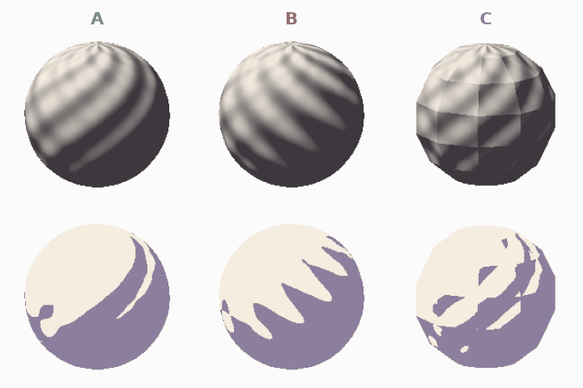

[日本語](../ja/08_normal-maps.md) | [English](../en/08_normal-maps.md) | [한국어](../ko/08_normal-maps.md)

[Contents](../README.md) · [← 7. Why toon shading shows normal errors](07_why-toon-shows-normal-errors.md) · Next: [9. Things to watch on export and import →](09_export-and-import.md)

# 8. Normal maps



*A: the normal map used correctly on smooth vertex normals. B: green (Y) read reversed. C: the same normal map on a flat-shaded low-poly sphere. Top: smooth, bottom: toon.*

**▶ Try it: [interactive figure (GitHub Pages)](https://gyogy6.github.io/Sayu_NormalsTips/en/ch08.html)**

## A normal map stores a tilt

A normal map is an image that stores a normal per pixel as a color. It adds the shading of fine bumps without adding vertices.

The **tangent-space** normal maps commonly used for characters do not store the normal itself. They store **which way, and how much, to tilt away from the vertex normal**.

## Three directions (tangent space)

For each pixel, three directions are prepared:

- **N**: the interpolated vertex normal (chapter 2)
- **T** (tangent): the horizontal UV direction (U increasing)
- **B** (bitangent): the vertical UV direction (V increasing)

The map color `(r, g, b)` is converted to -1…1, as in `x = 2r - 1`, and

```
normal = normalize( T × x + B × y + N × z )
```

A flat area is `(x, y, z) = (0, 0, 1)`, which as a color is the bluish `(0.5, 0.5, 1)`. That is why normal maps look blue.

## What matters

### 1. The base is the vertex normal

As the formula shows, the final normal is built **on top of the vertex normal N**. So:

- Changing the vertex normals (custom normals in chapter 5, seam handling in chapter 6) also changes how the normal map looks.
- With a flat base, the faces still show through the normal map (C in the GIF).

When a normal map is "baked" from a high-detail shape, the **vertex normals, T and B must be the same** when baking and when using it. If they differ, the baked bumps do not come back correctly, and seams or distortion appear.

### 2. Green (Y) has two conventions

Whether positive green points up or down in UV space differs between environments. Using a map made for the other convention **turns the bumps upside down**, and the lighting looks wrong (B in the GIF). If bumps look like dents, or light from above brightens the bottom, try flipping green.

### 3. T and B also split vertices

T and B come from the UVs, so at UV seams and where UVs are mirrored and reused left and right, T or B split. As in chapter 4, **the vertices split there**. If the split vertices do not compute T and B consistently, the normal map shows a seam.

### 4. With toon shading, normal map detail becomes lines too

As chapter 7 showed, toon shading turns small differences near the threshold into lines. The fine bumps of a normal map also come out strongly as jagged shadow edges (bottom row of the GIF). For toon shading, some choose a weaker map, or leave the normal map out of the shadow calculation.

## Summary

- A tangent-space normal map stores "the tilt from the vertex normal".
- Its base is the vertex normal plus T and B from the UVs. If any of them changes, the look changes.
- Green (Y) has two conventions; the wrong one turns bumps upside down.
- With toon shading, normal map detail shows up easily on the shadow edge.

---

[Contents](../README.md) · [← 7. Why toon shading shows normal errors](07_why-toon-shows-normal-errors.md) · Next: [9. Things to watch on export and import →](09_export-and-import.md)
