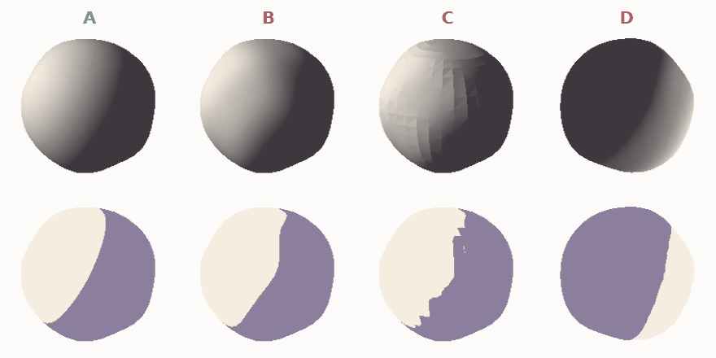

[日本語](../ja/09_export-and-import.md) | [English](../en/09_export-and-import.md) | [한국어](../ko/09_export-and-import.md)

[Contents](../README.md) · [← 8. Normal maps](08_normal-maps.md)

# 9. Things to watch on export and import

*A bumpy sphere with custom normals that clean up its shading. A: the normals in the file are used as is. B: normals recomputed on import. C: recomputed and split at a small angle. D: mirrored (negative scale) without fixing the face direction. Top: smooth, bottom: toon.*

**▶ Try it: [interactive figure (GitHub Pages)](https://gyogy6.github.io/Sayu_NormalsTips_WebPages/en/ch09.html)**

The shading looked clean where you made the model, but it changes when you bring it into another application or game engine. This happens a lot, and the usual cause is that **the normals were rebuilt along the way**.

## Where things change

A model goes "make → export → import → display". Normals tend to change at these points:

### Whether normals are stored at all

- Depending on the file format and export settings, either **the normals themselves are stored**, or **only the information about which areas are smooth**.
- In the second case, the importer recomputes the normals, so **custom normals do not survive** (B in the GIF).

### Whether the importer recomputes them

- Importers usually have a setting to "use the file's normals" or "compute them".
- When computing, **the averaging method (chapter 3) and the split angle (chapter 2) may differ** from where the model was made. A small split angle turns smooth areas into corners (C in the GIF).

### Tangents (T and B)

- The T and B used by normal maps are often computed by the importer.
- As chapter 8 showed, unless they are computed **the same way as when the normal map was baked**, the bumps do not come back correctly.

### How polygons are split into triangles

- Quads and polygons are split into triangles somewhere along the way. A different split changes interpolation (chapter 2) and uniform averaging (chapter 3).
- Triangulating yourself before export keeps the split from changing along the way.

### Whether vertices are merged

- Some importers have a setting to merge vertices at the same position or not. As chapter 4 showed, if normals are recomputed, unmerged vertices break the shading at seams.

### Mirroring (negative scale)

- If one axis of the scale is negative, the shape is mirrored and **the face direction (vertex order) is reversed**.
- If this is not fixed before normals are computed, the normals point inward and the lighting is reversed (D in the GIF).

### Storing with fewer bits

- To save space, normals are sometimes stored with fewer bits. That adds small errors, and as chapter 7 showed, toon shading can turn them into visible lines.

## How to check

- **Compare under the same conditions** where you made it and where you brought it: the same light direction, the same toon threshold. Toon shading finds small differences easily, so it is good for checking.
- **Show the vertex normals**: check that the directions match and that nothing is split at seams.
- **Change one thing at a time**: switch settings such as "use the file's normals / compute" one by one to find where the change happens.

## Summary

- Normals can be rebuilt during export and import.
- When they are rebuilt, custom normals and matched seams are lost.
- The averaging method, split angle, T and B, triangulation, vertex merging and mirroring all change the shading.
- Compare with the same light and the same toon settings, and check one step at a time.

---

[Contents](../README.md) · [← 8. Normal maps](08_normal-maps.md)
