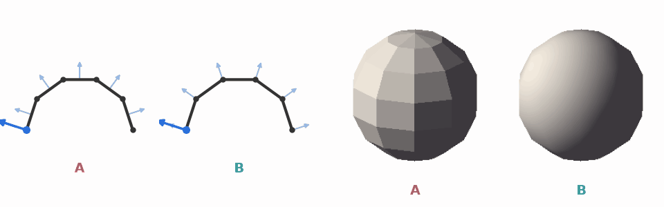
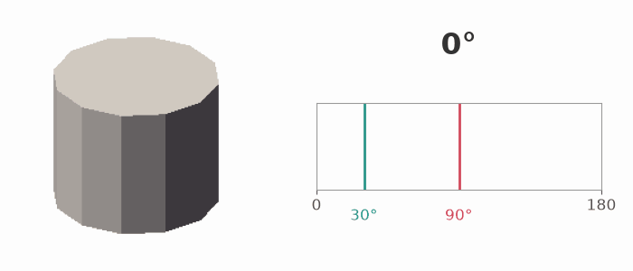

[日本語](../ja/02_face-and-vertex-normals.md) | [English](../en/02_face-and-vertex-normals.md) | [한국어](../ko/02_face-and-vertex-normals.md)

[目次](../README.ja.md) ・ [← 1. 法線とは](01_what-is-a-normal.md) ・ 次へ：[3. 頂点法線の平均のしかた →](03_averaging-vertex-normals.md)

# 2. 面の法線と頂点の法線



*A：フラット　B：スムーズ。左の 2 つは断面で、青い点が表面を動くときの法線の向き。A では面の境目で向きが急に変わり、B ではなめらかに回ります。右の 2 つは同じ低ポリゴンの球を、それぞれの法線で照らしたものです。*

**▶ 触って試す：[触れる図（GitHub Pages）](https://gyogy6.github.io/Sayu_NormalsTips/ja/ch02.html)**

## 面の法線

三角形の 3 つの頂点を `a, b, c` とすると、面の法線は 2 本の辺の **外積** で求められます。

```
n = normalize( (b - a) × (c - a) )
```

外積の向きは頂点の並び順で決まるので、並び順が逆だと法線も逆向きになります（1 章の「表と裏」）。
また、外積の **長さ** は三角形の面積の 2 倍です。これは 3 章で使います。

## 頂点の法線

実際に絵を描くときは、法線は **頂点ごと** に持たせます。三角形の中のピクセルでは、3 つの頂点の法線を、位置に応じて混ぜ合わせ（補間）、長さを 1 に戻してから明るさを計算します。

だから、頂点にどんな法線を置くかで、面の中の見た目が変わります。

### フラット（面の法線をそのまま使う）

三角形の 3 つの頂点すべてに、その面の法線を置きます。面の中はどこも同じ向きなので、明るさも同じです。面がひとつひとつ見える、角ばった見た目になります。

### スムーズ（まわりの面の平均を使う）

頂点に、その頂点を共有している **まわりの面の法線を平均した向き** を置きます。となりの三角形とも同じ向きを共有するので、面の境目で向きが飛ばず、明るさがなめらかにつながります。

ただし、変わるのは **影だけ** です。形（頂点の位置）はそのままなので、**輪郭（シルエット）は角ばったまま** です。GIF の B の球も、ふちを見ると多角形のままです。

## 角度で分ける

全部をスムーズにすると、困ることがあります。円柱の上面と側面のように、**本当に角になっている所** まで丸くなって、影がにじんでしまうのです。

そこで、**となり合う面の角度がしきい値より大きい所だけ、法線を分けて硬い角にする** という方法がよく使われます。



*12 角の円柱。側面どうしの角度は 30°、上面と側面の角度は 90°。しきい値の角度を 0° から 180° まで変えています。*

- しきい値が **30° より小さい**：どこも分かれるので、全部フラット。
- **30° 以上 90° 未満**：側面どうしはなめらかにつながり、上面のふちだけくっきり。たいていはこれがねらった見た目です。
- **90° 以上**：上面と側面まで混ざり、上面に影がにじみます。

（この図では、面どうしの法線の角度を比べて判定しています。）

## 1 つの位置に、法線が何本もある

角度で分けた所では、**同じ位置なのに、面ごとに違う法線** を持ちます。描くためのデータでは、1 つの頂点は 1 つの法線しか持てないので、このとき頂点は **位置が同じ別の頂点に分かれて** います。触れる図で「頂点の法線を表示」をオンにすると、円柱のふちで法線が 2 本ずつ出ているのが見えます。

頂点が分かれると、そこでは法線がつながらなくなります。これは 4 章（ハードエッジと UV の継ぎ目）で、もう少しくわしく見ます。

## まとめ

- 面の法線は辺の外積から求める。
- 法線は頂点ごとに持ち、三角形の中では補間される。
- フラットは面の法線、スムーズはまわりの面の平均。スムーズでも輪郭は変わらない。
- しきい値の角度で、なめらかにする所と角にする所を分けられる。分けた所では頂点が分かれる。

---

[目次](../README.ja.md) ・ [← 1. 法線とは](01_what-is-a-normal.md) ・ 次へ：[3. 頂点法線の平均のしかた →](03_averaging-vertex-normals.md)
