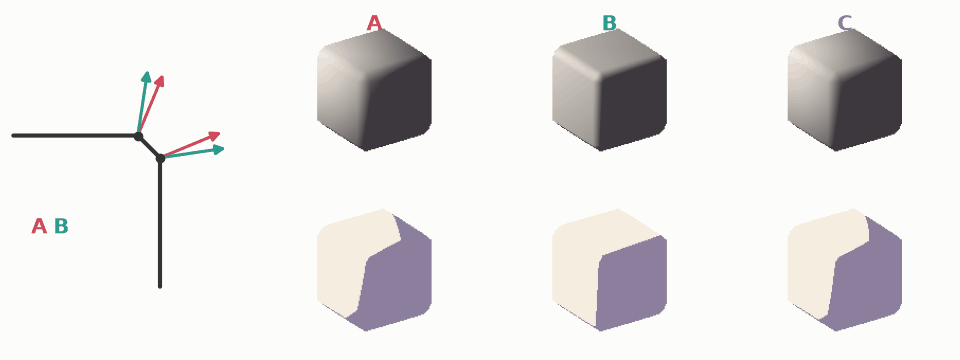
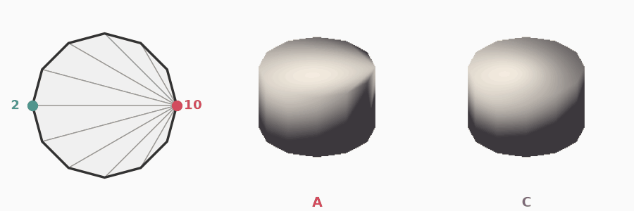

[日本語](../ja/03_averaging-vertex-normals.md) | [English](../en/03_averaging-vertex-normals.md) | [한국어](../ko/03_averaging-vertex-normals.md)

[目次](../README.ja.md) ・ [← 2. 面の法線と頂点の法線](02_face-and-vertex-normals.md) ・ 次へ：[4. ハードエッジと UV の継ぎ目 →](04_hard-edges-and-uv-seams.md)

# 3. 頂点法線の平均のしかた

**▶ 触って試す：[触れる図（GitHub Pages）](https://gyogy6.github.io/Sayu_NormalsTips/ja/ch03.html)**

2 章では「スムーズ＝まわりの面の法線の平均」と書きました。でも、**平均のしかたは 1 つではありません**。どれを使うかで、同じメッシュでも影の形が変わります。

## 平均の式

頂点のまわりの面の法線を `n₁, n₂, …`、それぞれの重みを `w₁, w₂, …` とすると、

```
頂点の法線 = normalize( w₁·n₁ + w₂·n₂ + … )
```

違うのは **重み `w` の決め方** だけです。よく使われるのは次の 3 つです。

| | 重み | 長所 | 気をつけること |
|---|---|---|---|
| **A 単純平均** | どの面も 1 | いちばん簡単 | 三角形の割り方で結果が変わる |
| **B 面積の重み** | 面の面積 | 大きい面の向きが保たれる | 小さい面の向きはほとんど効かない |
| **C 角度の重み** | その頂点での面の角の大きさ | 三角形の割り方に左右されない | 大きい面と小さい面の差は考えない |

B は、外積を **長さ 1 にしないまま** 足すだけで求められます（外積の長さは面積の 2 倍なので）。計算がいちばん安いので、よく使われます。

## 例 1：面取りした箱



*左：面取りした角の断面。広い面と細い面のあいだの頂点で、A（単純平均）は 2 つの面のちょうど真ん中を、B（面積の重み）は広い面に近い向きを指します。右：同じ箱を A・B・C で（上：なめらか、下：トゥーン）。*

- **B** では、広い面はほぼ平らな明るさのままで、曲がりは細い面取りの所に集まります。かっちりした物の見た目です。
- **A** と **C** では、広い面のはしまで影が流れ込み、トゥーンでは広い面の上に影の線が入りこみます。

## 例 2：三角形の割り方



*左：円柱のふたを上から見た図。1 つの頂点から扇形に三角形に割っています。赤い頂点には三角形が 10 個、緑の頂点には 2 個つながっています。右：A（単純平均）と C（角度の重み）。円柱を回しています。*

ふたは平らな 1 枚の面ですが、三角形に割ると、頂点ごとにつながる三角形の数がばらばらになります。

- **A 単純平均** は三角形の数で重みが決まるので、三角形が 10 個集まる赤い頂点だけ、法線がふたの向きに強く引っ張られます。回すと、そこだけ影がゆがむのがわかります。
- **C 角度の重み** では、平らな面をどう割っても、**その頂点のまわりの角の合計は変わりません**（ここでは 150°）。だから、割り方に関係なく同じ法線になります。

三角形の割り方は、書き出しのときなどに自動で変わることがあります。割り方で影が変わってしまう A は、その点で不利です。

## どれが正解？

**どれか 1 つが正解、ということはありません。**

- 丸い物（球・顔など）には、C（角度の重み）が素直なことが多いです。
- 面取りしたかっちりした物には、B（面積の重み）が向いています。
- A は簡単ですが、割り方に左右されます。

大事なのは、**同じメッシュでも、計算のしかたが違えば影が変わる** ということです。ソフトや設定によって使う方法は違うので、作ったときと別の所で法線を計算し直すと、影が変わることがあります。法線を自分で決めて保存する方法（カスタム法線）や、書き出し・読み込みでの注意は、あとの章で見ます。

## まとめ

- 頂点の法線は、まわりの面の法線の **重み付きの平均**。
- 重みは、単純平均・面積・角度の 3 つがよく使われる。
- 面積の重みは大きい面を守り、角度の重みは三角形の割り方に左右されない。
- 方法が違えば影も変わる。正解は 1 つではない。

---

[目次](../README.ja.md) ・ [← 2. 面の法線と頂点の法線](02_face-and-vertex-normals.md) ・ 次へ：[4. ハードエッジと UV の継ぎ目 →](04_hard-edges-and-uv-seams.md)
