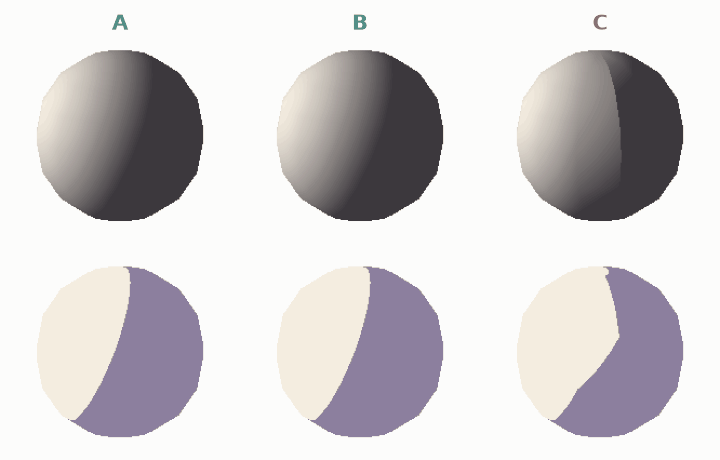

[日本語](../ja/04_hard-edges-and-uv-seams.md) | [English](../en/04_hard-edges-and-uv-seams.md) | [한국어](../ko/04_hard-edges-and-uv-seams.md)

[目次](../README.ja.md) ・ [← 3. 頂点法線の平均のしかた](03_averaging-vertex-normals.md) ・ 次へ：[5. カスタム法線 →](05_custom-normals.md)

# 4. ハードエッジと UV の継ぎ目

*手前の縦の線で頂点が分かれている球。A：頂点が分かれていない。B：分かれているが、法線はそろっている。C：分かれていて、法線を両側で別々に計算した。上：なめらか、下：トゥーン。*

**▶ 触って試す：[触れる図（GitHub Pages）](https://gyogy6.github.io/Sayu_NormalsTips/ja/ch04.html)**

## 描くときの「頂点」は、データの組

モデリングで見える頂点は「位置」ですが、描くときの頂点は **位置・法線・UV・色など、全部の組** です。組のうち **どれか 1 つでも違えば、別の頂点** になります。

だから、次のような所では、同じ位置に頂点が 2 つ以上できます。

| 場所 | 違うもの | 頂点 |
|---|---|---|
| ハードエッジ（2 章の「角度で分ける」所） | 法線 | 分かれる |
| UV の継ぎ目 | UV | 分かれる |
| 頂点カラーの境目など | 色など | 分かれる |

モデリングで見える頂点数より、描くときの頂点数が多くなるのはこのためです。

## 頂点が分かれても、影は割れない

大事なのは、**頂点が分かれていること自体は、影には関係ない** ということです。

- **A と B は同じ見た目** です。B は UV の継ぎ目と同じで、頂点は分かれていますが、両側の頂点が **同じ法線** を持っています。だから影はつながります。
- **C だけ影が割れます**。分かれた頂点が、それぞれ **自分の側の面だけ** で平均した法線を持つからです。両側で向きが違うので、継ぎ目に沿って明るさが食い違います。

影を割るのは「頂点が分かれていること」ではなく、**「分かれた頂点の法線が違うこと」** です。

## C が起きやすい場面

ハードエッジは、わざと法線を分けているので問題ありません。困るのは、**分けるつもりがないのに C になる** ときです。

- 法線を計算する前に、継ぎ目でメッシュを切り離していた。
- 位置は重なっているが、頂点がくっついていない（つながっていない）。
- 書き出しや読み込みのときに、つながりを見ずに法線を計算し直した。
- 継ぎ目の所だけ、別の方法で法線を計算した。

いずれも「両側の面をまとめて平均していない」のが原因です。

## 確かめ方

- **頂点の法線を表示する**：継ぎ目の上で、法線が 1 本に重なっていれば B、2 本に分かれていれば C です。
- **トゥーンで光を回す**：1 章で見たとおり、トゥーンはわずかな法線の差でも線になります。継ぎ目に沿って影の線が出たら、法線が食い違っています。

## まとめ

- 描くときの頂点は「位置・法線・UV…の組」。1 つでも違えば頂点は分かれる。
- 頂点が分かれていても、法線がそろっていれば影は割れない（UV の継ぎ目はふつうこれ）。
- 影が割れるのは、分かれた頂点の法線が違うとき。両側の面をまとめて平均すれば直る。

---

[目次](../README.ja.md) ・ [← 3. 頂点法線の平均のしかた](03_averaging-vertex-normals.md) ・ 次へ：[5. カスタム法線 →](05_custom-normals.md)
