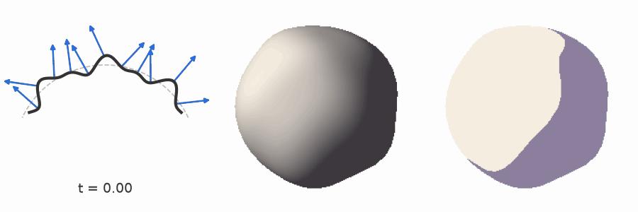

[日本語](../ja/05_custom-normals.md) | [English](../en/05_custom-normals.md) | [한국어](../ko/05_custom-normals.md)

[目次](../README.ja.md) ・ [← 4. ハードエッジと UV の継ぎ目](04_hard-edges-and-uv-seams.md) ・ 次へ：[6. 別々のメッシュの継ぎ目 →](06_seams-between-meshes.md)

# 5. カスタム法線

*左：でこぼこした面の断面と、その法線。t が 0 のときは面の形どおり、t が 1 のときは点線の円の法線（中心から外向き）になります。中・右：でこぼこした球に同じことをしたもの（なめらか／トゥーン）。輪郭はでこぼこのままです。*

**▶ 触って試す：[触れる図（GitHub Pages）](https://gyogy6.github.io/Sayu_NormalsTips_WebPages/ja/ch05.html)**

## 法線は、形から計算しなくてもいい

ここまでの章では、法線は形（頂点の位置）から計算するものでした。でも 1 章で見たとおり、**陰影を決めるのは法線だけ** です。

そこで、計算で出た法線の代わりに、**自分で決めた法線を頂点に保存する** ことができます。これを **カスタム法線** といいます。

- 形（頂点の位置）は変わらない。だから **輪郭も変わらない**。
- 変わるのは **影だけ**。

## よく使われる決め方

1. **向きを直接決める**：頂点を選んで、法線の向きを指定する。
2. **別の形から写す（転送）**：近くにある単純な形（球・楕円体・円柱など）を用意して、いちばん近い点の法線を写す。
3. **なめらかにする**：まわりの頂点の法線と平均して、乱れを減らす。

2 は、たくさんの頂点をまとめて整えられるので、よく使われます。GIF の例も 2 で、「でこぼこの球」に「なめらかな球」の法線を写しています。

## 例：トゥーンの顔の影

トゥーンの顔は、鼻・口・頬などの細かい凹凸があるので、計算どおりの法線だと影がまだらになりがちです。1 章のとおり、トゥーンはしきい値の近くの小さな差を線にしてしまうからです。

そこで、顔全体を包むような単純な形（球や楕円体など）から法線を写すと、影は **単純な形の影** のように、なめらかなまとまりになります。形はそのままなので、横から見た輪郭や、鼻の高さは変わりません。

どのくらい写すか（GIF の t）は、**見た目で決めます**。

- t が小さい：形に合った影。でもまだらになりやすい。
- t が大きい：整った影。でも形の凹凸が影に出なくなり、平らに見えることがある。

場所ごとに t を変える（たとえば、目のまわりは強く、ふちは弱く）ことも、よく行われます。

## 気をつけること

- **形と影が合わなくなる**：へこんでいるのに明るい、など。やりすぎると不自然になります。
- **輪郭は変わらない**：シルエットのでこぼこは、法線では消せません。
- **作り直されると消える**：法線を計算し直す操作（角度で分ける設定の変更、形の編集、書き出し・読み込みでの再計算など）で、カスタム法線が消えることがあります。保存されるか、作業の流れの中で確かめます。
- **ノーマルマップにも影響する**：ノーマルマップは頂点の法線を基準にしているので、頂点の法線を変えると、ノーマルマップの見え方も変わります（8 章）。

## まとめ

- カスタム法線は、計算の代わりに自分で決めた法線。形は変えずに影だけを変える。
- 単純な形から写す（転送）と、たくさんの頂点をまとめて整えられる。
- トゥーンの顔の影をまとめるのによく使われる。どのくらい写すかは見た目で決める。
- 計算し直すと消えることがあるので、保存されるか確かめる。

---

[目次](../README.ja.md) ・ [← 4. ハードエッジと UV の継ぎ目](04_hard-edges-and-uv-seams.md) ・ 次へ：[6. 別々のメッシュの継ぎ目 →](06_seams-between-meshes.md)
