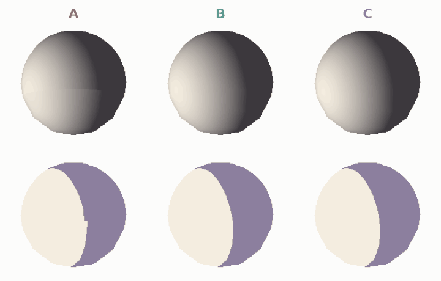
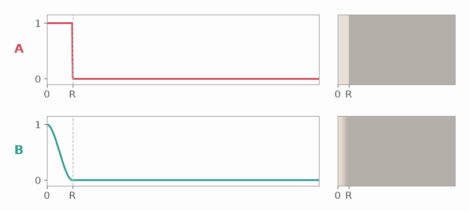

[日本語](../ja/06_seams-between-meshes.md) | [English](../en/06_seams-between-meshes.md) | [한국어](../ko/06_seams-between-meshes.md)

[目次](../README.ja.md) ・ [← 5. カスタム法線](05_custom-normals.md) ・ 次へ：[7. トゥーンで法線の差が目立つ理由 →](07_why-toon-shows-normal-errors.md)

# 6. 別々のメッシュの継ぎ目



*上と下が別々のメッシュでできた球（分け方の細かさも違う）。A：そのまま。B：継ぎ目の頂点だけ法線をそろえた。C：継ぎ目の近くで、なめらかな形の法線を、距離で弱めながら写した。上：なめらか、下：トゥーン。*

**▶ 触って試す：[触れる図（GitHub Pages）](https://gyogy6.github.io/Sayu_NormalsTips_WebPages/ja/ch06.html)**

## なぜ割れるのか

顔と首、手と袖、体と服のように、**別々のメッシュが接している所** では、位置がぴったり合っていても影が割れることがあります。

理由は 4 章の C と同じです。それぞれのメッシュは、**自分の面だけ** で頂点の法線を平均します。継ぎ目の頂点は、片方では上側の面だけ、もう片方では下側の面だけで平均されるので、**両側で法線の向きが違う** のです。GIF の A の下段（トゥーン）で、継ぎ目に段ができているのがそれです。

さらに、2 つのメッシュの細かさが違うと、継ぎ目の近くの法線のふるまいも違います。

## 方法 1：継ぎ目の頂点の法線をそろえる

いちばん簡単なのは、**継ぎ目の両側の頂点に、同じ法線を入れる** ことです。

- 両側の面をまとめて平均する（つないだ形として計算する）。
- どちらか一方の法線に、もう一方を合わせる。

GIF の B がこれで、継ぎ目の段は消えます。法線は 5 章のカスタム法線として保存します。

## 方法 2：法線を写す（転送）

継ぎ目の頂点だけでなく、**まわりもまとめて整えたい** ときは、5 章の「別の形から写す」を使います。元にする形は、たとえば次のようなものです。

- もう一方のメッシュ
- 2 つをつないだ形
- 継ぎ目をまたいで包む、なめらかな代わりの形

GIF の C は、なめらかな球を元にして、継ぎ目から範囲 R の中に法線を写しています。

## 方法 3：距離で弱める（減衰）

写す範囲のはしで、いきなり「写した法線」から「元の法線」に切り替えると、**そこに新しい段差** ができてしまいます。



*横軸：継ぎ目からの距離。縦軸：写す強さ w（1 = 全部写す、0 = 元のまま）。右の帯は、その結果の明るさ。A：範囲 R で急に切り替える。B：距離に合わせてなめらかに弱める。R を変えています。*

そこで、写す強さ `w` を **継ぎ目からの距離に合わせて少しずつ弱め**、

```
法線 = normalize( 元の法線 × (1 - w) + 写す法線 × w )
```

のように混ぜます。B のように、継ぎ目では全部写し、範囲のはしでは 0 になるようにすると、明るさがなめらかにつながります。弱め方は、直線より、はしで傾きが 0 になるなめらかな曲線のほうが、境目が目立ちにくくなります。

## 気をつけること

- **継ぎ目の頂点の位置や数が合っていない**：同じ位置の頂点がないときは、いちばん近い点を探して写します。
- **動かしたあと**：ボーンで曲げたり、表情で形を変えたりすると、法線の向きも変わります。動かしたあとでも継ぎ目がそろっているか確かめます。
- **作り直されると消える**：5 章と同じく、そろえた法線が書き出し・読み込みで計算し直されないか確かめます。

## まとめ

- 別々のメッシュは自分の面だけで法線を平均するので、位置が合っていても継ぎ目で法線が食い違う。
- 継ぎ目の頂点の法線をそろえれば、段は消える。
- まわりも整えたいときは、元にする形から法線を写す。
- 写す強さは継ぎ目からの距離で弱め、範囲のはしに新しい段を作らない。

---

[目次](../README.ja.md) ・ [← 5. カスタム法線](05_custom-normals.md) ・ 次へ：[7. トゥーンで法線の差が目立つ理由 →](07_why-toon-shows-normal-errors.md)
