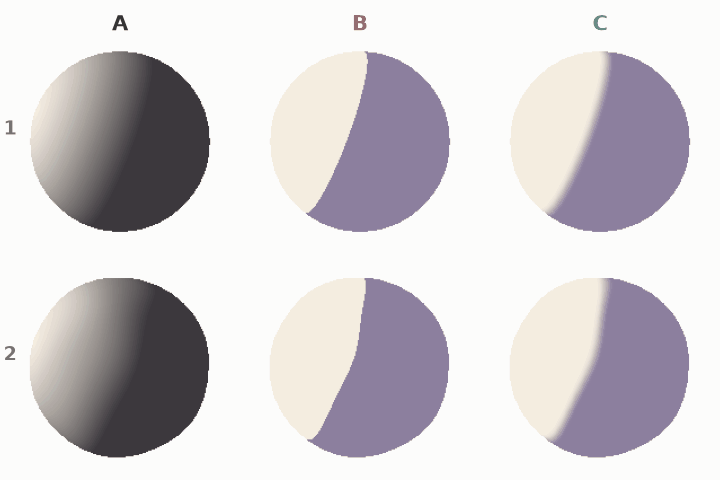
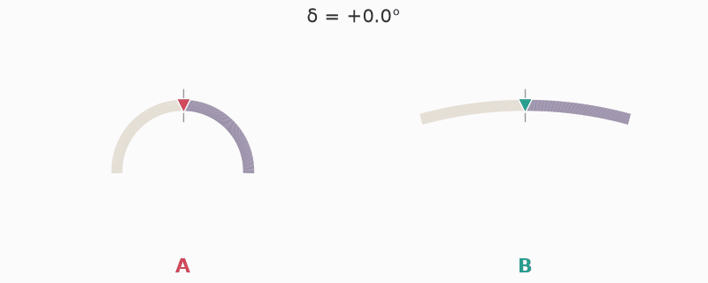

[日本語](../ja/07_why-toon-shows-normal-errors.md) | [English](../en/07_why-toon-shows-normal-errors.md) | [한국어](../ko/07_why-toon-shows-normal-errors.md)

[目次](../README.ja.md) ・ [← 6. 別々のメッシュの継ぎ目](06_seams-between-meshes.md) ・ 次へ：[8. ノーマルマップとの関係 →](08_normal-maps.md)

# 7. トゥーンで法線の差が目立つ理由



*1：なめらかな球。2：ほとんど見えないほど小さなでこぼこを付けた球。A：なめらかな明るさ。B：トゥーン。C：影のふちを少しぼかしたトゥーン。*

**▶ 触って試す：[触れる図（GitHub Pages）](https://gyogy6.github.io/Sayu_NormalsTips_WebPages/ja/ch07.html)**

ここまでの章で何度も「トゥーンでは法線の差が目立つ」と書きました。この章では、その理由を 2 つに分けて見ます。

## 理由 1：しきい値で、明るさが一気に変わる

なめらかな明るさ `max(0, N·L)` では、法線が少し（δ）傾いても、明るさは少ししか変わりません。おおよそ

```
明るさの変化 ≈ sin θ × δ
```

です（θ は光との角度、δ はラジアン）。たとえば δ = 2° なら、変化はいちばん大きくても 0.035 ほどで、目ではほとんどわかりません。GIF の A の 2 段目が、1 段目とほとんど同じに見えるのはこのためです。

ところがトゥーンでは、`N·L` がしきい値をまたぐと、**明るい色と影の色が丸ごと入れ替わります**。変化の大きさは、δ がどれだけ小さくても「1 段まるごと」です。だから、しきい値の近くにある小さな法線の乱れは、そのまま **影のふちの形** になって見えます（B の 2 段目の、波打つふち）。

## 理由 2：ゆるい面ほど、影のふちが大きく動く

もう 1 つの理由は、面の **曲がり方** です。



*A：よく曲がった面（半径が小さい）。B：ゆるく曲がった面（半径が大きい）。どちらも法線を同じ角度 δ だけ傾けています。▼ が影のふち。*

影のふちは「`N·L` がしきい値と同じになる所」です。法線を δ だけ傾けると、ふちは **法線の向きが δ だけ変わる所まで** 動きます。動く長さは、

```
ふちの動き ≈ 曲がりの半径 × δ
```

です。よく曲がった所（半径が小さい）では、少し動くだけで向きが変わるので、ふちはあまり動きません。でも **頬やおでこのような、ゆるく曲がった所** では、同じ δ でもふちが大きく動きます。

つまり、**ゆるい面ほど、法線の小さな差がはっきりした影の動きや形の乱れとして見える** ということです。

## 対策の考え方

- **法線を整える**：乱れの元を減らす（5 章のカスタム法線、6 章の継ぎ目の処理）。
- **影のふちを少しぼかす**：しきい値の前後をなめらかにつなぐと、小さな乱れが線になりにくくなります（GIF の C）。ぼかしすぎるとトゥーンらしさが減るので、少しだけにします。
- **しきい値の近くに来やすい所を気にする**：光の向きが決まっている場合、影のふちが通りやすい場所の法線を特に丁寧に整えます。

## まとめ

- トゥーンはしきい値で色が丸ごと入れ替わるので、しきい値の近くの小さな法線の差が線になる。
- 影のふちの動きは「曲がりの半径 × 法線の傾き」。ゆるい面ほど大きく動く。
- 法線を整える、影のふちを少しぼかす、が基本の対策。

---

[目次](../README.ja.md) ・ [← 6. 別々のメッシュの継ぎ目](06_seams-between-meshes.md) ・ 次へ：[8. ノーマルマップとの関係 →](08_normal-maps.md)
