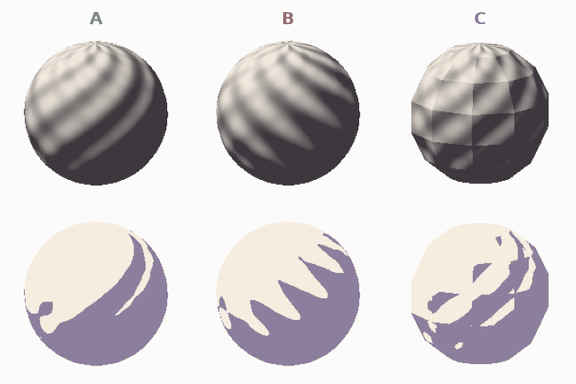

[日本語](../ja/08_normal-maps.md) | [English](../en/08_normal-maps.md) | [한국어](../ko/08_normal-maps.md)

[目次](../README.ja.md) ・ [← 7. トゥーンで法線の差が目立つ理由](07_why-toon-shows-normal-errors.md) ・ 次へ：[9. 書き出し・読み込みでの注意 →](09_export-and-import.md)

# 8. ノーマルマップとの関係



*A：なめらかな頂点の法線に、ノーマルマップを正しく使った。B：緑（Y）を反対に読んだ。C：同じノーマルマップを、フラットな低ポリゴンの球に使った。上：なめらか、下：トゥーン。*

**▶ 触って試す：[触れる図（GitHub Pages）](https://gyogy6.github.io/Sayu_NormalsTips_WebPages/ja/ch08.html)**

## ノーマルマップは「傾き」の情報

ノーマルマップは、ピクセルごとの法線を色で保存した画像です。頂点の数を増やさずに、細かいでこぼこの影を出せます。

キャラクターなどでよく使われる **タンジェント空間** のノーマルマップは、法線そのものではなく、**頂点の法線から、どちらにどれだけ傾けるか** を保存しています。

## 3 本の向き（タンジェント空間）

ピクセルごとに、次の 3 本の向きを用意します。

- **N**：頂点の法線を補間したもの（2 章）
- **T**（タンジェント）：UV の横（U が増える）方向
- **B**（バイタンジェント）：UV の縦（V が増える）方向

ノーマルマップの色 `(r, g, b)` を `x = 2r - 1` のように -1〜1 に直して、

```
法線 = normalize( T × x + B × y + N × z )
```

とします。でこぼこのない所は `(x, y, z) = (0, 0, 1)` で、色にすると `(0.5, 0.5, 1)` の青紫です。ノーマルマップが青っぽく見えるのはこのためです。

## 大事なこと

### 1. 土台は頂点の法線

式のとおり、最後の法線は **頂点の法線 N を土台にして** 決まります。だから、

- 頂点の法線を変える（5 章のカスタム法線、6 章の継ぎ目の処理）と、ノーマルマップの見え方も変わります。
- 土台がフラットだと、ノーマルマップを使っても面の角が見えます（GIF の C）。

ノーマルマップを高い形から「焼く（ベイク）」場合は、焼いたときと使うときで、**同じ頂点の法線・同じ T と B** になっている必要があります。違うと、焼いたでこぼこが正しく戻らず、継ぎ目やゆがみが出ます。

### 2. 緑（Y）の向きには 2 つの決まりがある

B の向き（緑のプラスを UV の上向きにするか、下向きにするか）は、環境によって決まりが違います。違う決まりで作ったノーマルマップをそのまま使うと、**でこぼこの上下が逆** になり、光の当たり方がおかしくなります（GIF の B）。でっぱりなのにへこみのように見える、上から光を当てると下が明るい、などのときは、緑を反転して確かめます。

### 3. T と B も、頂点が分かれる理由になる

T と B は UV から決まるので、UV の継ぎ目や、左右で UV を反転して使い回している所では、T や B が分かれます。4 章と同じく、**そこでは頂点が分かれます**。分かれた頂点どうしで T・B の計算がそろっていないと、ノーマルマップの継ぎ目が見えます。

### 4. トゥーンでは、ノーマルマップの細かさも線になる

7 章のとおり、トゥーンはしきい値の近くの小さな差を線にします。ノーマルマップの細かいでこぼこも、トゥーンでは影のふちのギザギザとして強く出ます（GIF の下段）。トゥーンで使うときは、強さを控えめにする、または影の計算にはノーマルマップを使わない、という選び方もあります。

## まとめ

- タンジェント空間のノーマルマップは「頂点の法線からの傾き」を保存している。
- 土台は頂点の法線と、UV から決まる T・B。どれかが変わると見え方も変わる。
- 緑（Y）の向きには 2 つの決まりがあり、違うと上下が逆になる。
- トゥーンでは、ノーマルマップの細かさも影のふちに出やすい。

---

[目次](../README.ja.md) ・ [← 7. トゥーンで法線の差が目立つ理由](07_why-toon-shows-normal-errors.md) ・ 次へ：[9. 書き出し・読み込みでの注意 →](09_export-and-import.md)
