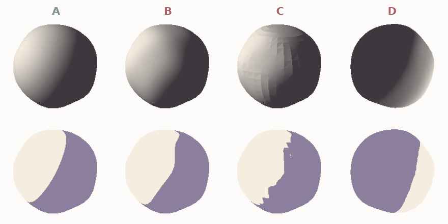

[日本語](../ja/09_export-and-import.md) | [English](../en/09_export-and-import.md) | [한국어](../ko/09_export-and-import.md)

[目次](../README.ja.md) ・ [← 8. ノーマルマップとの関係](08_normal-maps.md)

# 9. 書き出し・読み込みでの注意

*影を整えたカスタム法線を持つ、でこぼこの球。A：ファイルの法線をそのまま使った。B：読み込むときに法線を計算し直した。C：小さい角度で分けて計算し直した。D：鏡に映した（マイナスの拡大）のに、面の向きを直さなかった。上：なめらか、下：トゥーン。*

**▶ 触って試す：[触れる図（GitHub Pages）](https://gyogy6.github.io/Sayu_NormalsTips_WebPages/ja/ch09.html)**

作った所では影がきれいだったのに、別のソフトやゲームエンジンに持っていくと影が変わる。よくあることです。原因の多くは、**途中で法線が作り直されている** ことです。

## どこで変わるのか

モデルは「作る → 書き出す → 読み込む → 表示する」と進みます。法線が変わりやすいのは、次のような所です。

### 法線を保存するか、しないか

- ファイル形式や書き出しの設定によって、**法線そのものを保存する** 場合と、**「どこをなめらかにするか」の情報だけを保存する** 場合があります。
- 後者では、読み込む側で法線を計算し直すので、**カスタム法線は残りません**（GIF の B）。

### 読み込む側で、計算し直すか

- 読み込む側には、たいてい「ファイルの法線を使う」か「計算する」かの設定があります。
- 計算する場合は、**平均のしかた（3 章）や、分ける角度（2 章）が作った所と違う** かもしれません。小さい角度で分けると、なめらかな所まで角になります（GIF の C）。

### タンジェント（T・B）

- ノーマルマップに使う T・B は、読み込む側で計算することが多いです。
- 8 章のとおり、**ノーマルマップを焼いたときと同じ計算方法** でないと、でこぼこが正しく戻りません。

### 三角形の割り方

- 四角形や多角形は、どこかで三角形に割られます。割り方が変わると、補間（2 章）や単純平均（3 章）の結果が変わります。
- 書き出す前に自分で三角形にしておくと、割り方が途中で変わりません。

### 頂点をくっつけるか

- 読み込むときに、同じ位置の頂点をくっつける／くっつけない設定があることがあります。4 章のとおり、法線を計算し直すなら、くっつけていないと継ぎ目で影が割れます。

### 鏡に映した（マイナスの拡大縮小）

- 拡大縮小のどれか 1 つの軸がマイナスだと、形は鏡に映ったようになり、**面の向き（頂点の並び順）が裏返ります**。
- これを直さないまま法線を計算すると、法線が内側を向いて、明るさが反対になります（GIF の D）。

### 少ないビット数での保存

- データを小さくするために、法線を少ないビット数で保存することがあります。小さな誤差ができ、7 章のとおり、トゥーンではそれが線になって見えることがあります。

## 確かめ方

- **作った所と、持っていった先で、同じ条件で比べる**：同じ向きの光、同じトゥーンのしきい値で見比べます。トゥーンは小さな差を見つけやすいので、確認に向いています。
- **頂点の法線を表示する**：向きがそろっているか、継ぎ目で分かれていないかを見ます。
- **1 つずつ切り替える**：「ファイルの法線を使う／計算する」などの設定を 1 つずつ変えて、どこで変わるのかを確かめます。

## まとめ

- 法線は、書き出し・読み込みの途中で作り直されることがある。
- 作り直されると、カスタム法線や、そろえた継ぎ目が消える。
- 平均のしかた・分ける角度・T と B・三角形の割り方・頂点のくっつけ方・鏡に映したかどうかで、影が変わる。
- 同じ光・同じトゥーンで見比べて、どこで変わったかを 1 つずつ確かめる。

---

[目次](../README.ja.md) ・ [← 8. ノーマルマップとの関係](08_normal-maps.md)
