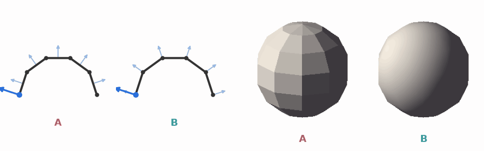
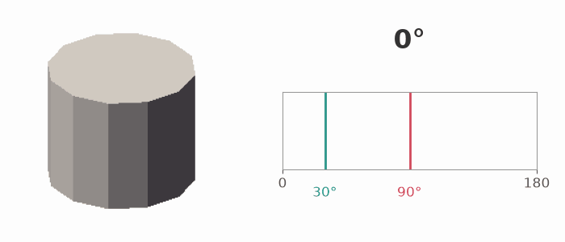

[日本語](../ja/02_face-and-vertex-normals.md) | [English](../en/02_face-and-vertex-normals.md) | [한국어](../ko/02_face-and-vertex-normals.md)

[목차](../README.ko.md) · [← 1. 법선이란](01_what-is-a-normal.md) · 다음: [3. 정점 법선을 평균 내는 방법 →](03_averaging-vertex-normals.md)

# 2. 면 법선과 정점 법선



*A: 플랫, B: 스무스. 왼쪽 두 개는 단면으로, 파란 점이 표면을 따라 움직일 때의 법선 방향입니다. A에서는 면의 경계에서 방향이 갑자기 바뀌고, B에서는 매끄럽게 돌아갑니다. 오른쪽 두 개는 같은 로우폴리 구를 각각의 법선으로 비춘 것입니다.*

**▶ 직접 해 보기: [움직이는 그림 (GitHub Pages)](https://gyogy6.github.io/Sayu_NormalsTips_WebPages/ko/ch02.html)**

## 면 법선

삼각형의 세 정점을 `a, b, c`라고 하면, 면 법선은 두 변의 **외적**으로 구합니다.

```
n = normalize( (b - a) × (c - a) )
```

외적의 방향은 정점 순서로 정해지므로, 순서가 반대면 법선도 반대 방향이 됩니다(1장의 '앞과 뒤').
또 외적의 **길이**는 삼각형 넓이의 2배입니다. 이것은 3장에서 씁니다.

## 정점 법선

실제로 그릴 때는 법선을 **정점마다** 둡니다. 삼각형 안의 픽셀에서는 세 정점의 법선을 위치에 따라 섞고(보간), 길이를 1로 되돌린 뒤 밝기를 계산합니다.

그래서 정점에 어떤 법선을 두느냐에 따라 면 안의 모습이 달라집니다.

### 플랫 (면 법선을 그대로 쓴다)

삼각형의 세 정점 모두에 그 면의 법선을 둡니다. 면 안은 어디나 같은 방향이므로 밝기도 같습니다. 면 하나하나가 보이는 각진 모습이 됩니다.

### 스무스 (주변 면의 평균을 쓴다)

정점에, 그 정점을 공유하는 **주변 면 법선의 평균 방향**을 둡니다. 이웃한 삼각형과 같은 방향을 공유하므로 면의 경계에서 방향이 튀지 않고 밝기가 매끄럽게 이어집니다.

다만 바뀌는 것은 **그림자뿐**입니다. 모양(정점 위치)은 그대로이므로 **윤곽(실루엣)은 각진 그대로**입니다. GIF의 B 구도 가장자리를 보면 다각형 그대로입니다.

## 각도로 나누기

전부 스무스로 하면 곤란한 경우가 있습니다. 원기둥의 윗면과 옆면처럼 **정말로 모서리인 곳**까지 둥글어져서 그림자가 번지는 것입니다.

그래서 **이웃한 면의 각도가 임계값보다 큰 곳만 법선을 나누어 단단한 모서리로 만드는** 방법을 많이 씁니다.



*12각 원기둥. 옆면끼리의 각도는 30°, 윗면과 옆면의 각도는 90°. 임계 각도를 0°에서 180°까지 바꾸고 있습니다.*

- 임계값이 **30°보다 작음**: 모두 나뉘므로 전부 플랫.
- **30° 이상 90° 미만**: 옆면끼리는 매끄럽게 이어지고, 윗면 가장자리만 또렷합니다. 보통 이것이 원하는 모습입니다.
- **90° 이상**: 윗면과 옆면까지 섞여서 윗면에 그림자가 번집니다.

(이 그림에서는 면 법선끼리의 각도를 비교해서 판단합니다.)

## 한 위치에 법선이 여러 개

각도로 나눈 곳에서는 **같은 위치인데도 면마다 다른 법선**을 가집니다. 그리기 위한 데이터에서는 정점 하나가 법선을 하나만 가질 수 있으므로, 이때 정점은 **위치가 같은 다른 정점으로 나뉘어** 있습니다. 움직이는 그림에서 '정점 법선 표시'를 켜면 원기둥 가장자리에서 법선이 두 개씩 나와 있는 것이 보입니다.

정점이 나뉘면 그곳에서는 법선이 이어지지 않습니다. 이것은 4장(하드 엣지와 UV 이음매)에서 좀 더 자세히 봅니다.

## 정리

- 면 법선은 변의 외적으로 구한다.
- 법선은 정점마다 두고, 삼각형 안에서는 보간된다.
- 플랫은 면 법선, 스무스는 주변 면의 평균. 스무스여도 윤곽은 바뀌지 않는다.
- 임계 각도로 매끄럽게 할 곳과 모서리로 할 곳을 나눌 수 있다. 나눈 곳에서는 정점이 나뉜다.

---

[목차](../README.ko.md) · [← 1. 법선이란](01_what-is-a-normal.md) · 다음: [3. 정점 법선을 평균 내는 방법 →](03_averaging-vertex-normals.md)
