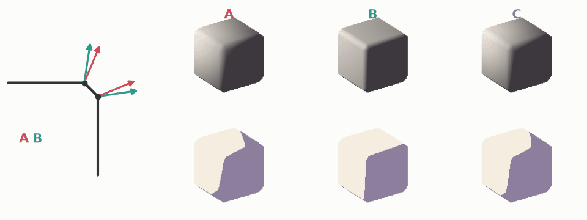
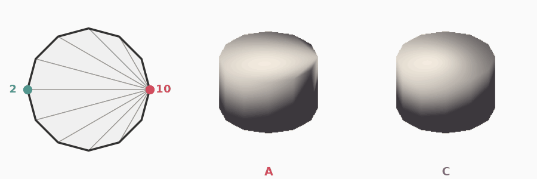

[日本語](../ja/03_averaging-vertex-normals.md) | [English](../en/03_averaging-vertex-normals.md) | [한국어](../ko/03_averaging-vertex-normals.md)

[목차](../README.ko.md) · [← 2. 면 법선과 정점 법선](02_face-and-vertex-normals.md) · 다음: [4. 하드 엣지와 UV 이음매 →](04_hard-edges-and-uv-seams.md)

# 3. 정점 법선을 평균 내는 방법

**▶ 직접 해 보기: [움직이는 그림 (GitHub Pages)](https://gyogy6.github.io/Sayu_NormalsTips_WebPages/ko/ch03.html)**

2장에서 '스무스 = 주변 면 법선의 평균'이라고 썼습니다. 하지만 **평균을 내는 방법은 하나가 아닙니다**. 어느 것을 쓰느냐에 따라 같은 메시라도 그림자 모양이 달라집니다.

## 평균의 식

정점 주변 면의 법선을 `n₁, n₂, …`, 각각의 가중치를 `w₁, w₂, …`라고 하면,

```
정점 법선 = normalize( w₁·n₁ + w₂·n₂ + … )
```

다른 것은 **가중치 `w`를 정하는 방법**뿐입니다. 자주 쓰는 것은 다음 세 가지입니다.

| | 가중치 | 장점 | 주의할 점 |
|---|---|---|---|
| **A 단순 평균** | 모든 면이 1 | 가장 간단 | 삼각형을 나누는 방식에 따라 결과가 달라짐 |
| **B 면적 가중치** | 면의 넓이 | 큰 면의 방향이 유지됨 | 작은 면의 방향은 거의 반영되지 않음 |
| **C 각도 가중치** | 그 정점에서의 면의 각도 | 삼각형 나누는 방식에 영향을 받지 않음 | 큰 면과 작은 면의 차이는 고려하지 않음 |

B는 외적을 **길이 1로 만들지 않고** 더하기만 하면 구할 수 있습니다(외적의 길이가 넓이의 2배이므로). 계산이 가장 싸서 많이 쓰입니다.

## 예 1: 모서리를 깎은 상자



*왼쪽: 깎은 모서리의 단면. 넓은 면과 좁은 면 사이의 정점에서 A(단순 평균)는 두 면의 정확히 가운데를, B(면적 가중치)는 넓은 면에 가까운 방향을 가리킵니다. 오른쪽: 같은 상자를 A, B, C로(위: 매끄러움, 아래: 툰).*

- **B**에서는 넓은 면이 거의 평평한 밝기를 유지하고, 휘어짐은 좁게 깎인 부분에 모입니다. 단단한 물체다운 모습입니다.
- **A**와 **C**에서는 넓은 면의 가장자리까지 그림자가 흘러들고, 툰에서는 넓은 면 위로 그림자 선이 파고듭니다.

## 예 2: 삼각형을 나누는 방식



*왼쪽: 원기둥 뚜껑을 위에서 본 그림. 한 정점에서 부채꼴로 삼각형을 나눴습니다. 빨간 정점에는 삼각형 10개, 초록 정점에는 2개가 이어져 있습니다. 오른쪽: A(단순 평균)와 C(각도 가중치). 원기둥을 돌리고 있습니다.*

뚜껑은 평평한 한 장의 면이지만, 삼각형으로 나누면 정점마다 이어지는 삼각형 수가 제각각이 됩니다.

- **A 단순 평균**은 삼각형 수로 가중치가 정해지므로, 삼각형 10개가 모인 빨간 정점만 법선이 뚜껑 방향으로 강하게 끌려갑니다. 돌려 보면 그곳만 그림자가 일그러지는 것을 알 수 있습니다.
- **C 각도 가중치**에서는 평평한 면을 어떻게 나눠도 **그 정점 주변 각도의 합은 바뀌지 않습니다**(여기서는 150°). 그래서 나누는 방식과 상관없이 같은 법선이 됩니다.

삼각형을 나누는 방식은 내보낼 때 등에 자동으로 바뀔 수 있습니다. 나누는 방식에 따라 그림자가 바뀌는 A는 그 점에서 불리합니다.

## 어느 것이 정답?

**어느 하나만 정답인 것은 아닙니다.**

- 둥근 물체(구, 얼굴 등)에는 C(각도 가중치)가 자연스러운 경우가 많습니다.
- 모서리를 깎은 단단한 물체에는 B(면적 가중치)가 잘 맞습니다.
- A는 간단하지만 나누는 방식에 영향을 받습니다.

중요한 것은 **같은 메시라도 계산 방법이 다르면 그림자가 달라진다**는 것입니다. 소프트웨어나 설정에 따라 쓰는 방법이 다르므로, 만든 곳과 다른 곳에서 법선을 다시 계산하면 그림자가 바뀔 수 있습니다. 법선을 직접 정해서 저장하는 방법(커스텀 법선)과 내보내기·불러오기에서 주의할 점은 뒤의 장에서 봅니다.

## 정리

- 정점 법선은 주변 면 법선의 **가중 평균**.
- 가중치는 단순 평균, 면적, 각도의 세 가지가 자주 쓰인다.
- 면적 가중치는 큰 면을 지키고, 각도 가중치는 삼각형 나누는 방식에 영향을 받지 않는다.
- 방법이 다르면 그림자도 달라진다. 정답은 하나가 아니다.

---

[목차](../README.ko.md) · [← 2. 면 법선과 정점 법선](02_face-and-vertex-normals.md) · 다음: [4. 하드 엣지와 UV 이음매 →](04_hard-edges-and-uv-seams.md)
