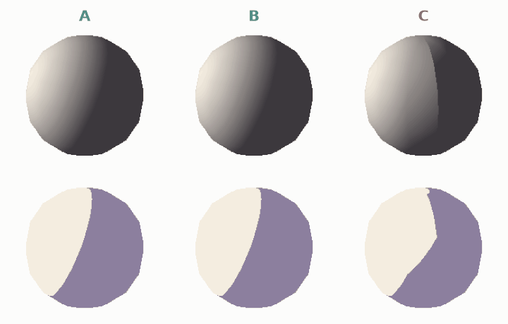

[日本語](../ja/04_hard-edges-and-uv-seams.md) | [English](../en/04_hard-edges-and-uv-seams.md) | [한국어](../ko/04_hard-edges-and-uv-seams.md)

[목차](../README.ko.md) · [← 3. 정점 법선을 평균 내는 방법](03_averaging-vertex-normals.md) · 다음: [5. 커스텀 법선 →](05_custom-normals.md)

# 4. 하드 엣지와 UV 이음매

*앞쪽 세로선에서 정점이 나뉜 구. A: 정점이 나뉘지 않음. B: 나뉘었지만 법선은 맞춰져 있음. C: 나뉘었고, 법선을 양쪽에서 따로 계산함. 위: 매끄러움, 아래: 툰.*

**▶ 직접 해 보기: [움직이는 그림 (GitHub Pages)](https://gyogy6.github.io/Sayu_NormalsTips_WebPages/ko/ch04.html)**

## 그릴 때의 '정점'은 데이터 묶음

모델링에서 보이는 정점은 '위치'이지만, 그릴 때의 정점은 **위치, 법선, UV, 색 등 전부의 묶음**입니다. 묶음 중 **하나라도 다르면 다른 정점**이 됩니다.

그래서 다음과 같은 곳에서는 같은 위치에 정점이 두 개 이상 생깁니다.

| 곳 | 다른 것 | 정점 |
|---|---|---|
| 하드 엣지 (2장의 '각도로 나누기' 하는 곳) | 법선 | 나뉨 |
| UV 이음매 | UV | 나뉨 |
| 정점 컬러의 경계 등 | 색 등 | 나뉨 |

모델링에서 보이는 정점 수보다 그릴 때의 정점 수가 많아지는 것은 이 때문입니다.

## 정점이 나뉘어도 그림자는 갈라지지 않는다

중요한 것은 **정점이 나뉜 것 자체는 그림자와 상관없다**는 점입니다.

- **A와 B는 같은 모습**입니다. B는 UV 이음매와 같아서 정점은 나뉘어 있지만, 양쪽 정점이 **같은 법선**을 가집니다. 그래서 그림자가 이어집니다.
- **C만 그림자가 갈라집니다.** 나뉜 정점이 각각 **자기 쪽 면으로만** 평균 낸 법선을 가지기 때문입니다. 양쪽 방향이 달라서 이음매를 따라 밝기가 어긋납니다.

그림자를 가르는 것은 '정점이 나뉜 것'이 아니라 **'나뉜 정점의 법선이 다른 것'**입니다.

## C가 생기기 쉬운 경우

하드 엣지는 일부러 법선을 나눈 것이므로 문제없습니다. 곤란한 것은 **나눌 생각이 없는데 C가 되는** 경우입니다.

- 법선을 계산하기 전에 이음매에서 메시를 잘라 놓았다.
- 위치는 겹쳐 있지만 정점이 붙어 있지 않다(이어져 있지 않다).
- 내보내기나 불러오기 때 연결을 보지 않고 법선을 다시 계산했다.
- 이음매 부분만 다른 방법으로 법선을 계산했다.

모두 '양쪽 면을 함께 평균 내지 않은 것'이 원인입니다.

## 확인 방법

- **정점 법선을 표시한다**: 이음매 위에서 법선이 하나로 겹쳐 있으면 B, 두 개로 나뉘어 있으면 C입니다.
- **툰으로 빛을 돌린다**: 1장에서 본 것처럼 툰은 아주 작은 법선 차이도 선으로 만듭니다. 이음매를 따라 그림자 선이 생기면 법선이 어긋난 것입니다.

## 정리

- 그릴 때의 정점은 '위치, 법선, UV…의 묶음'. 하나라도 다르면 정점이 나뉜다.
- 정점이 나뉘어도 법선이 맞으면 그림자는 갈라지지 않는다(UV 이음매는 보통 이렇다).
- 그림자가 갈라지는 것은 나뉜 정점의 법선이 다를 때. 양쪽 면을 함께 평균 내면 고쳐진다.

---

[목차](../README.ko.md) · [← 3. 정점 법선을 평균 내는 방법](03_averaging-vertex-normals.md) · 다음: [5. 커스텀 법선 →](05_custom-normals.md)
