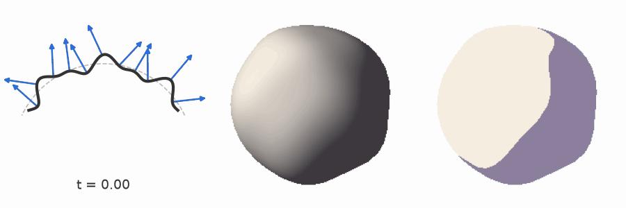

[日本語](../ja/05_custom-normals.md) | [English](../en/05_custom-normals.md) | [한국어](../ko/05_custom-normals.md)

[목차](../README.ko.md) · [← 4. 하드 엣지와 UV 이음매](04_hard-edges-and-uv-seams.md) · 다음: [6. 따로 있는 메시의 이음매 →](06_seams-between-meshes.md)

# 5. 커스텀 법선

*왼쪽: 울퉁불퉁한 면의 단면과 그 법선. t가 0이면 면 모양 그대로, t가 1이면 점선 원의 법선(중심에서 바깥쪽)이 됩니다. 가운데·오른쪽: 울퉁불퉁한 구에 같은 것을 한 것(매끄러움 / 툰). 윤곽은 울퉁불퉁한 그대로입니다.*

**▶ 직접 해 보기: [움직이는 그림 (GitHub Pages)](https://gyogy6.github.io/Sayu_NormalsTips_WebPages/ko/ch05.html)**

## 법선은 모양에서 계산하지 않아도 된다

지금까지의 장에서 법선은 모양(정점 위치)에서 계산하는 것이었습니다. 하지만 1장에서 본 것처럼 **음영을 정하는 것은 법선뿐**입니다.

그래서 계산으로 나온 법선 대신 **직접 정한 법선을 정점에 저장**할 수 있습니다. 이것을 **커스텀 법선**이라고 합니다.

- 모양(정점 위치)은 바뀌지 않는다. 그래서 **윤곽도 바뀌지 않는다**.
- 바뀌는 것은 **그림자뿐**.

## 자주 쓰는 방법

1. **방향을 직접 정한다**: 정점을 골라 법선 방향을 지정한다.
2. **다른 모양에서 옮긴다(전송)**: 가까이에 단순한 모양(구, 타원체, 원기둥 등)을 준비하고, 가장 가까운 점의 법선을 옮긴다.
3. **매끄럽게 한다**: 주변 정점의 법선과 평균 내서 흐트러짐을 줄인다.

2는 많은 정점을 한꺼번에 정돈할 수 있어서 많이 쓰입니다. GIF의 예도 2로, '울퉁불퉁한 구'에 '매끄러운 구'의 법선을 옮기고 있습니다.

## 예: 툰 얼굴의 그림자

툰 얼굴은 코, 입, 볼 같은 작은 요철이 있어서, 계산한 그대로의 법선이면 그림자가 얼룩덜룩해지기 쉽습니다. 1장에서 본 것처럼 툰은 임계값 근처의 작은 차이를 선으로 만들어 버리기 때문입니다.

그래서 얼굴 전체를 감싸는 단순한 모양(구, 타원체 등)에서 법선을 옮기면, 그림자는 **단순한 모양의 그림자**처럼 매끄럽게 정리됩니다. 모양은 그대로이므로 옆에서 본 윤곽이나 코의 높이는 바뀌지 않습니다.

얼마나 옮길지(GIF의 t)는 **눈으로 보고 정합니다**.

- t가 작다: 모양에 맞는 그림자. 하지만 얼룩지기 쉽다.
- t가 크다: 정돈된 그림자. 하지만 모양의 요철이 그림자에 나타나지 않아 평평해 보일 수 있다.

곳마다 t를 바꾸는 것(예: 눈 주변은 강하게, 가장자리는 약하게)도 자주 합니다.

## 주의할 점

- **모양과 그림자가 맞지 않게 된다**: 들어갔는데 밝다 등. 지나치면 부자연스럽습니다.
- **윤곽은 바뀌지 않는다**: 실루엣의 요철은 법선으로 없앨 수 없습니다.
- **다시 계산하면 사라진다**: 법선을 다시 계산하는 작업(각도로 나누기 설정 변경, 모양 편집, 내보내기·불러오기에서의 재계산 등)으로 커스텀 법선이 사라질 수 있습니다. 작업 흐름 안에서 저장되는지 확인합니다.
- **노멀 맵에도 영향을 준다**: 노멀 맵은 정점 법선을 기준으로 하므로, 정점 법선을 바꾸면 노멀 맵이 보이는 모습도 바뀝니다(8장).

## 정리

- 커스텀 법선은 계산 대신 직접 정한 법선. 모양은 바꾸지 않고 그림자만 바꾼다.
- 단순한 모양에서 옮기면(전송) 많은 정점을 한꺼번에 정돈할 수 있다.
- 툰 얼굴의 그림자를 정리하는 데 자주 쓰인다. 얼마나 옮길지는 눈으로 정한다.
- 다시 계산하면 사라질 수 있으므로 저장되는지 확인한다.

---

[목차](../README.ko.md) · [← 4. 하드 엣지와 UV 이음매](04_hard-edges-and-uv-seams.md) · 다음: [6. 따로 있는 메시의 이음매 →](06_seams-between-meshes.md)
