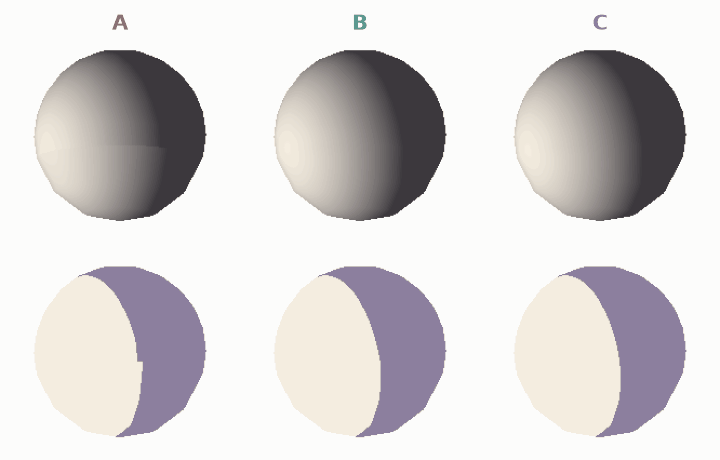
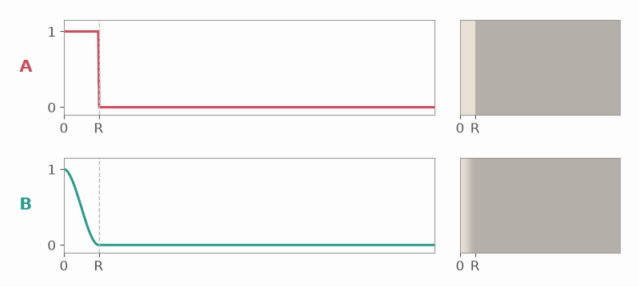

[日本語](../ja/06_seams-between-meshes.md) | [English](../en/06_seams-between-meshes.md) | [한국어](../ko/06_seams-between-meshes.md)

[목차](../README.ko.md) · [← 5. 커스텀 법선](05_custom-normals.md) · 다음: [7. 툰에서 법선 차이가 눈에 띄는 이유 →](07_why-toon-shows-normal-errors.md)

# 6. 따로 있는 메시의 이음매



*위와 아래가 따로 있는 메시로 된 구(나누는 촘촘함도 다름). A: 그대로. B: 이음매 정점만 법선을 맞춤. C: 이음매 근처에서 매끄러운 모양의 법선을 거리에 따라 약하게 하면서 옮김. 위: 매끄러움, 아래: 툰.*

**▶ 직접 해 보기: [움직이는 그림 (GitHub Pages)](https://gyogy6.github.io/Sayu_NormalsTips_WebPages/ko/ch06.html)**

## 왜 갈라지는가

얼굴과 목, 손과 소매, 몸과 옷처럼 **따로 있는 메시가 맞닿는 곳**에서는 위치가 정확히 맞아도 그림자가 갈라질 수 있습니다.

이유는 4장의 C와 같습니다. 각 메시는 **자기 면으로만** 정점 법선을 평균 냅니다. 이음매 정점은 한쪽에서는 위쪽 면만, 다른 쪽에서는 아래쪽 면만으로 평균이 나므로 **양쪽 법선 방향이 다릅니다**. GIF의 A 아래 줄(툰)에서 이음매에 단이 생긴 것이 그것입니다.

게다가 두 메시의 촘촘함이 다르면 이음매 근처 법선의 움직임도 다릅니다.

## 방법 1: 이음매 정점의 법선을 맞춘다

가장 간단한 것은 **이음매 양쪽 정점에 같은 법선을 넣는 것**입니다.

- 양쪽 면을 함께 평균 낸다(이어 붙인 모양으로 계산한다).
- 한쪽 법선에 다른 쪽을 맞춘다.

GIF의 B가 이것으로, 이음매의 단이 사라집니다. 법선은 5장의 커스텀 법선으로 저장합니다.

## 방법 2: 법선을 옮긴다(전송)

이음매 정점뿐 아니라 **주변까지 함께 정돈하고 싶을** 때는 5장의 '다른 모양에서 옮긴다'를 씁니다. 기준이 되는 모양은 예를 들면 다음과 같습니다.

- 다른 쪽 메시
- 둘을 이어 붙인 모양
- 이음매를 가로질러 감싸는 매끄러운 대체 모양

GIF의 C는 매끄러운 구를 기준으로, 이음매에서 범위 R 안에 법선을 옮기고 있습니다.

## 방법 3: 거리에 따라 약하게(감쇠)

옮기는 범위의 끝에서 갑자기 '옮긴 법선'에서 '원래 법선'으로 바꾸면 **그곳에 새로운 단**이 생깁니다.



*가로축: 이음매로부터의 거리. 세로축: 옮기는 세기 w(1 = 전부 옮김, 0 = 원래 그대로). 오른쪽 띠는 그 결과의 밝기. A: 범위 R에서 갑자기 바꿈. B: 거리에 따라 매끄럽게 약하게 함. R을 바꾸고 있습니다.*

그래서 옮기는 세기 `w`를 **이음매로부터의 거리에 맞춰 조금씩 약하게** 하고,

```
법선 = normalize( 원래 법선 × (1 - w) + 옮길 법선 × w )
```

처럼 섞습니다. B처럼 이음매에서는 전부 옮기고 범위 끝에서는 0이 되게 하면 밝기가 매끄럽게 이어집니다. 약하게 하는 방식은 직선보다 끝에서 기울기가 0이 되는 매끄러운 곡선이 경계가 덜 눈에 띕니다.

## 주의할 점

- **이음매 정점의 위치나 수가 맞지 않는다**: 같은 위치의 정점이 없으면 가장 가까운 점을 찾아서 옮깁니다.
- **움직인 뒤**: 본으로 구부리거나 표정으로 모양을 바꾸면 법선 방향도 바뀝니다. 움직인 뒤에도 이음매가 맞는지 확인합니다.
- **다시 계산하면 사라진다**: 5장과 마찬가지로, 맞춘 법선이 내보내기·불러오기에서 다시 계산되지 않는지 확인합니다.

## 정리

- 따로 있는 메시는 자기 면으로만 법선을 평균 내므로, 위치가 맞아도 이음매에서 법선이 어긋난다.
- 이음매 정점의 법선을 맞추면 단이 사라진다.
- 주변도 정돈하고 싶으면 기준 모양에서 법선을 옮긴다.
- 옮기는 세기는 이음매로부터의 거리에 따라 약하게 해서, 범위 끝에 새로운 단을 만들지 않는다.

---

[목차](../README.ko.md) · [← 5. 커스텀 법선](05_custom-normals.md) · 다음: [7. 툰에서 법선 차이가 눈에 띄는 이유 →](07_why-toon-shows-normal-errors.md)
