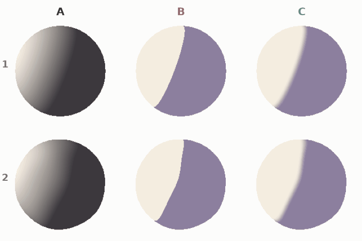
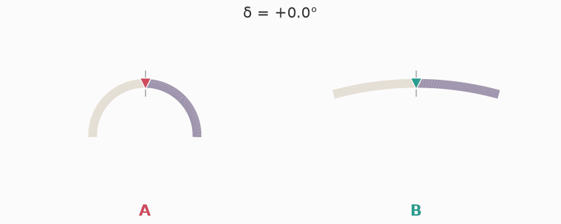

[日本語](../ja/07_why-toon-shows-normal-errors.md) | [English](../en/07_why-toon-shows-normal-errors.md) | [한국어](../ko/07_why-toon-shows-normal-errors.md)

[목차](../README.ko.md) · [← 6. 따로 있는 메시의 이음매](06_seams-between-meshes.md) · 다음: [8. 노멀 맵과의 관계 →](08_normal-maps.md)

# 7. 툰에서 법선 차이가 눈에 띄는 이유



*1: 매끄러운 구. 2: 거의 보이지 않을 만큼 작은 요철을 붙인 구. A: 매끄러운 밝기. B: 툰. C: 그림자 가장자리를 조금 흐리게 한 툰.*

**▶ 직접 해 보기: [움직이는 그림 (GitHub Pages)](https://gyogy6.github.io/Sayu_NormalsTips_WebPages/ko/ch07.html)**

지금까지 여러 번 '툰에서는 법선 차이가 눈에 띈다'고 썼습니다. 이 장에서는 그 이유를 두 가지로 나눠서 봅니다.

## 이유 1: 임계값에서 밝기가 한꺼번에 바뀐다

매끄러운 밝기 `max(0, N·L)`에서는 법선이 조금(δ) 기울어도 밝기는 조금만 바뀝니다. 대략

```
밝기 변화 ≈ sin θ × δ
```

입니다(θ는 빛과의 각도, δ는 라디안). 예를 들어 δ = 2°이면 변화는 가장 커도 0.035 정도로, 눈으로는 거의 알 수 없습니다. GIF의 A 두 번째 줄이 첫 번째 줄과 거의 같아 보이는 이유입니다.

그런데 툰에서는 `N·L`이 임계값을 넘으면 **밝은 색과 그림자 색이 통째로 바뀝니다**. δ가 아무리 작아도 변화는 '한 단계 통째로'입니다. 그래서 임계값 근처의 작은 법선 흐트러짐은 그대로 **그림자 가장자리의 모양**이 되어 보입니다(B 두 번째 줄의 물결치는 가장자리).

## 이유 2: 완만한 면일수록 그림자 가장자리가 크게 움직인다

또 하나의 이유는 면이 **휘는 정도**입니다.



*A: 많이 휜 면(반지름이 작음). B: 완만하게 휜 면(반지름이 큼). 둘 다 법선을 같은 각도 δ만큼 기울였습니다. ▼가 그림자 가장자리.*

그림자 가장자리는 '`N·L`이 임계값과 같아지는 곳'입니다. 법선을 δ만큼 기울이면 가장자리는 **법선 방향이 δ만큼 바뀌는 곳까지** 움직입니다. 움직이는 길이는

```
가장자리 이동 ≈ 휘어짐의 반지름 × δ
```

입니다. 많이 휜 곳(반지름이 작음)에서는 조금만 가도 방향이 바뀌므로 가장자리가 별로 움직이지 않습니다. 하지만 **볼이나 이마처럼 완만하게 휜 곳**에서는 같은 δ라도 가장자리가 크게 움직입니다.

즉, **완만한 면일수록 작은 법선 차이가 그림자의 뚜렷한 움직임이나 모양의 흐트러짐으로 보인다**는 것입니다.

## 대책의 생각 방식

- **법선을 정돈한다**: 흐트러짐의 원인을 줄인다(5장의 커스텀 법선, 6장의 이음매 처리).
- **그림자 가장자리를 조금 흐리게 한다**: 임계값 앞뒤를 매끄럽게 이으면 작은 흐트러짐이 선이 되기 어렵습니다(GIF의 C). 너무 흐리게 하면 툰다움이 줄어드므로 조금만 합니다.
- **임계값 근처에 오기 쉬운 곳을 신경 쓴다**: 빛 방향이 정해져 있다면 그림자 가장자리가 지나가기 쉬운 곳의 법선을 특히 꼼꼼히 정돈합니다.

## 정리

- 툰은 임계값에서 색이 통째로 바뀌므로, 임계값 근처의 작은 법선 차이가 선이 된다.
- 그림자 가장자리의 이동은 '휘어짐의 반지름 × 법선 기울기'. 완만한 면일수록 크게 움직인다.
- 법선 정돈과 그림자 가장자리를 조금 흐리게 하는 것이 기본 대책.

---

[목차](../README.ko.md) · [← 6. 따로 있는 메시의 이음매](06_seams-between-meshes.md) · 다음: [8. 노멀 맵과의 관계 →](08_normal-maps.md)
