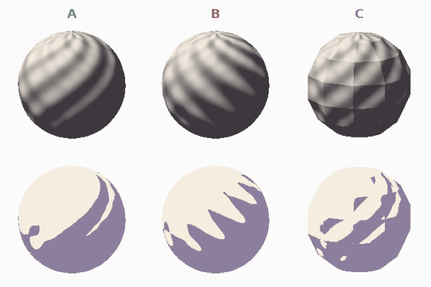

[日本語](../ja/08_normal-maps.md) | [English](../en/08_normal-maps.md) | [한국어](../ko/08_normal-maps.md)

[목차](../README.ko.md) · [← 7. 툰에서 법선 차이가 눈에 띄는 이유](07_why-toon-shows-normal-errors.md) · 다음: [9. 내보내기·불러오기에서 주의할 점 →](09_export-and-import.md)

# 8. 노멀 맵과의 관계



*A: 매끄러운 정점 법선에 노멀 맵을 바르게 사용. B: 초록(Y)을 반대로 읽음. C: 같은 노멀 맵을 플랫한 로우폴리 구에 사용. 위: 매끄러움, 아래: 툰.*

**▶ 직접 해 보기: [움직이는 그림 (GitHub Pages)](https://gyogy6.github.io/Sayu_NormalsTips_WebPages/ko/ch08.html)**

## 노멀 맵은 '기울기' 정보

노멀 맵은 픽셀마다의 법선을 색으로 저장한 이미지입니다. 정점 수를 늘리지 않고 작은 요철의 그림자를 낼 수 있습니다.

캐릭터 등에 자주 쓰는 **탄젠트 공간** 노멀 맵은 법선 자체가 아니라, **정점 법선에서 어느 쪽으로 얼마나 기울일지**를 저장합니다.

## 세 방향 (탄젠트 공간)

픽셀마다 다음 세 방향을 준비합니다.

- **N**: 정점 법선을 보간한 것(2장)
- **T**(탄젠트): UV의 가로(U가 커지는) 방향
- **B**(바이탄젠트): UV의 세로(V가 커지는) 방향

노멀 맵의 색 `(r, g, b)`를 `x = 2r - 1`처럼 -1~1로 바꾸고,

```
법선 = normalize( T × x + B × y + N × z )
```

로 합니다. 요철이 없는 곳은 `(x, y, z) = (0, 0, 1)`이고, 색으로는 `(0.5, 0.5, 1)`의 푸른 보라색입니다. 노멀 맵이 파랗게 보이는 이유입니다.

## 중요한 점

### 1. 바탕은 정점 법선

식대로 최종 법선은 **정점 법선 N을 바탕으로** 정해집니다. 그래서

- 정점 법선을 바꾸면(5장의 커스텀 법선, 6장의 이음매 처리) 노멀 맵이 보이는 모습도 바뀝니다.
- 바탕이 플랫이면 노멀 맵을 써도 면의 모서리가 보입니다(GIF의 C).

노멀 맵을 고해상도 모양에서 '굽는(베이크)' 경우, 구울 때와 쓸 때 **같은 정점 법선, 같은 T와 B**여야 합니다. 다르면 구운 요철이 바르게 돌아오지 않아 이음매나 일그러짐이 생깁니다.

### 2. 초록(Y) 방향에는 두 가지 규칙이 있다

초록의 플러스를 UV의 위쪽으로 할지 아래쪽으로 할지는 환경에 따라 규칙이 다릅니다. 다른 규칙으로 만든 노멀 맵을 그대로 쓰면 **요철의 위아래가 뒤집혀** 빛이 이상하게 닿습니다(GIF의 B). 튀어나온 곳이 들어간 것처럼 보이거나, 위에서 빛을 비추는데 아래가 밝다면 초록을 반전해서 확인합니다.

### 3. T와 B도 정점이 나뉘는 이유가 된다

T와 B는 UV에서 정해지므로, UV 이음매나 좌우로 UV를 반전해서 재사용하는 곳에서는 T나 B가 나뉩니다. 4장과 마찬가지로 **그곳에서는 정점이 나뉩니다**. 나뉜 정점끼리 T·B 계산이 맞지 않으면 노멀 맵의 이음매가 보입니다.

### 4. 툰에서는 노멀 맵의 세밀함도 선이 된다

7장에서 본 것처럼 툰은 임계값 근처의 작은 차이를 선으로 만듭니다. 노멀 맵의 작은 요철도 툰에서는 그림자 가장자리의 들쭉날쭉함으로 강하게 나타납니다(GIF의 아래 줄). 툰에서 쓸 때는 세기를 약하게 하거나, 그림자 계산에는 노멀 맵을 쓰지 않는 선택도 있습니다.

## 정리

- 탄젠트 공간 노멀 맵은 '정점 법선으로부터의 기울기'를 저장한다.
- 바탕은 정점 법선과 UV에서 정해지는 T·B. 어느 하나가 바뀌면 모습도 바뀐다.
- 초록(Y) 방향에는 두 가지 규칙이 있고, 다르면 위아래가 뒤집힌다.
- 툰에서는 노멀 맵의 세밀함도 그림자 가장자리에 나타나기 쉽다.

---

[목차](../README.ko.md) · [← 7. 툰에서 법선 차이가 눈에 띄는 이유](07_why-toon-shows-normal-errors.md) · 다음: [9. 내보내기·불러오기에서 주의할 점 →](09_export-and-import.md)
