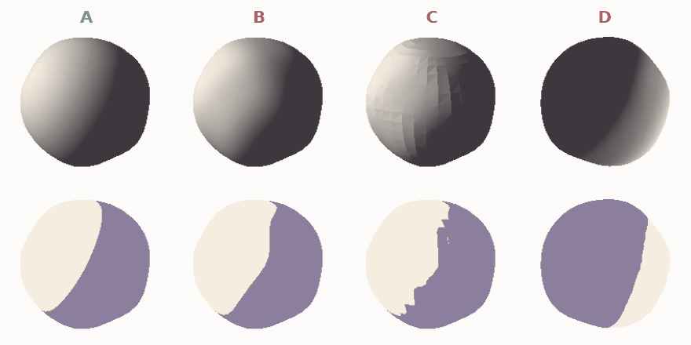

[日本語](../ja/09_export-and-import.md) | [English](../en/09_export-and-import.md) | [한국어](../ko/09_export-and-import.md)

[목차](../README.ko.md) · [← 8. 노멀 맵과의 관계](08_normal-maps.md)

# 9. 내보내기·불러오기에서 주의할 점

*그림자를 정돈한 커스텀 법선을 가진 울퉁불퉁한 구. A: 파일의 법선을 그대로 사용. B: 불러올 때 법선을 다시 계산. C: 작은 각도로 나누어 다시 계산. D: 거울 반전(음수 스케일)했는데 면 방향을 고치지 않음. 위: 매끄러움, 아래: 툰.*

**▶ 직접 해 보기: [움직이는 그림 (GitHub Pages)](https://gyogy6.github.io/Sayu_NormalsTips/ko/ch09.html)**

만든 곳에서는 그림자가 깨끗했는데, 다른 소프트웨어나 게임 엔진으로 가져가면 그림자가 바뀝니다. 흔한 일입니다. 원인의 대부분은 **도중에 법선이 다시 만들어진 것**입니다.

## 어디서 바뀌는가

모델은 '만든다 → 내보낸다 → 불러온다 → 표시한다'로 진행됩니다. 법선이 바뀌기 쉬운 곳은 다음과 같습니다.

### 법선을 저장하는가, 하지 않는가

- 파일 형식이나 내보내기 설정에 따라 **법선 자체를 저장하는** 경우와 **'어디를 매끄럽게 할지' 정보만 저장하는** 경우가 있습니다.
- 후자는 불러오는 쪽에서 법선을 다시 계산하므로 **커스텀 법선이 남지 않습니다**(GIF의 B).

### 불러오는 쪽에서 다시 계산하는가

- 불러오는 쪽에는 보통 '파일의 법선을 사용' 또는 '계산' 설정이 있습니다.
- 계산하는 경우 **평균 방법(3장)이나 나누는 각도(2장)가 만든 곳과 다를** 수 있습니다. 작은 각도로 나누면 매끄러운 곳까지 모서리가 됩니다(GIF의 C).

### 탄젠트 (T·B)

- 노멀 맵에 쓰는 T·B는 불러오는 쪽에서 계산하는 경우가 많습니다.
- 8장에서 본 것처럼 **노멀 맵을 구울 때와 같은 계산 방법**이 아니면 요철이 바르게 돌아오지 않습니다.

### 삼각형으로 나누는 방식

- 사각형이나 다각형은 어딘가에서 삼각형으로 나뉩니다. 나누는 방식이 바뀌면 보간(2장)이나 단순 평균(3장)의 결과가 바뀝니다.
- 내보내기 전에 직접 삼각형으로 만들어 두면 도중에 나누는 방식이 바뀌지 않습니다.

### 정점을 붙이는가

- 불러올 때 같은 위치의 정점을 붙일지 말지 설정이 있는 경우가 있습니다. 4장에서 본 것처럼 법선을 다시 계산한다면 붙이지 않았을 때 이음매에서 그림자가 갈라집니다.

### 거울 반전 (음수 스케일)

- 스케일의 어느 한 축이 음수이면 모양이 거울에 비친 것처럼 되고, **면 방향(정점 순서)이 뒤집힙니다**.
- 이것을 고치지 않고 법선을 계산하면 법선이 안쪽을 향해 밝기가 반대가 됩니다(GIF의 D).

### 적은 비트 수로 저장

- 데이터를 작게 하려고 법선을 적은 비트 수로 저장하는 경우가 있습니다. 작은 오차가 생기고, 7장에서 본 것처럼 툰에서는 그것이 선으로 보일 수 있습니다.

## 확인 방법

- **만든 곳과 가져간 곳을 같은 조건으로 비교한다**: 같은 방향의 빛, 같은 툰 임계값으로 비교합니다. 툰은 작은 차이를 찾기 쉬워서 확인에 알맞습니다.
- **정점 법선을 표시한다**: 방향이 맞는지, 이음매에서 나뉘어 있지 않은지 봅니다.
- **하나씩 바꾼다**: '파일의 법선 사용 / 계산' 같은 설정을 하나씩 바꿔서 어디서 바뀌는지 확인합니다.

## 정리

- 법선은 내보내기·불러오기 도중에 다시 만들어질 수 있다.
- 다시 만들어지면 커스텀 법선이나 맞춘 이음매가 사라진다.
- 평균 방법, 나누는 각도, T와 B, 삼각형 나누는 방식, 정점 붙이기, 거울 반전 여부에 따라 그림자가 바뀐다.
- 같은 빛, 같은 툰으로 비교하며 어디서 바뀌었는지 하나씩 확인한다.

---

[목차](../README.ko.md) · [← 8. 노멀 맵과의 관계](08_normal-maps.md)
